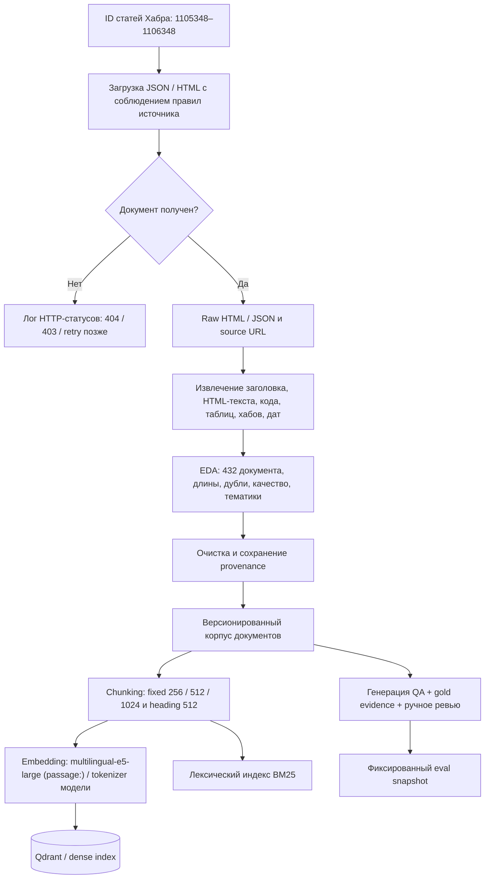
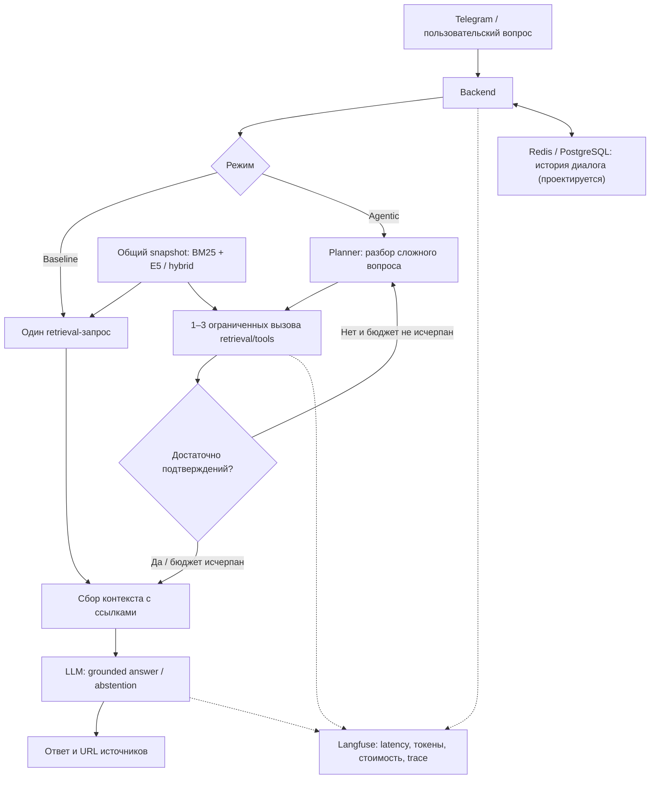

# ML System Design Doc — Agent-Enhanced Corporate Search (RAG / Agentic RAG, PoC)

**Проект:** корпоративный поисковый ассистент с RAG и агентным поиском.  
**Итерация:** учебный Proof of Concept, домашнее задание № 2.  
**Версия документа:** 1.0, 13 ноября 2026 г.  
**Фактически исследованный источник:** статьи Хабра.  
**Планируемые источники расширенного PoC:** демонстрационная wiki/документы и Asana как аналог трекера задач.  
**Состояние:** EDA корпуса Хабра и сравнение структуры чанков проведены; eval-набор, результаты retrieval/LLM и бизнес-эффект **пока не измерены**.

> **Важно о статусе данных.** В документе обозначения **«Факт EDA»**, **«Проектное решение»**, **«Гипотеза»** и **«План/не проверено»** используются намеренно. Числовые метрики корпуса рассчитаны из CSV-файлов исследования. KPI, SLA и пороги успешности PoC — целевые критерии, перенесённые и уточнённые из исходного дизайн-документа, а не результаты тестирования работающей системы.
>
> 
> **Границы доказательств:** EDA проведён на **432 статьях Хабра** из запрошенного диапазона ID **1105348–1106348**. Он не подтверждает качество данных Asana/wiki и не позволяет делать выводы о производительности Agentic RAG.

**Основание:** [задание № 2](https://gist.github.com/pacifikus/bada0e4b597852e4bb50512daf451929), [шаблон ML System Design Doc](https://github.com/IrinaGoloshchapova/ml_system_design_doc_ru/blob/main/ML_System_Design_Doc_Template.md). Документ продолжает исходную концепцию *Agent-Enhanced Corporate Search* и детализирует раздел **2.3 «Этапы решения задачи»** на основании EDA.

---

## 1. Цели и предпосылки

### 1.1. Зачем идём в разработку продукта?

**Проблема.** В корпоративной среде технические знания распределены между документацией, wiki, задачами и внешними публикациями. Сотрудник вынужден искать материалы в нескольких системах, сверять версии и даты, находить контекст решений. Особенно трудно отвечать на вопросы, требующие сопоставления нескольких источников.

**Цель продукта** — дать пользователю возможность задавать вопрос на естественном языке и получать проверяемый ответ со ссылками на исходные документы, а для составных запросов — выполнять несколько целенаправленных поисковых шагов.

**Почему не достаточно обычного поиска:** BM25 хорошо находит точные идентификаторы и названия, но может хуже обрабатывать переформулировки; single-pass RAG отвечает по одному набору найденных фрагментов, который может оказаться неполным; Agentic RAG потенциально может разбивать сложный запрос и повторять поиск после проверки достаточности контекста. Успешность этого усложнения предстоит подтвердить экспериментально.

**Оценка масштаба — гипотетический пример, не замер:** 50 сотрудников × 20 минут поиска в день × 20 рабочих дней / 60 = **≈ 333 человеко-часа в месяц**. Возможное сокращение этого времени на 25% означало бы **≈ 83 часа в месяц**. Экономия фактических затрат компании не подтверждена, поскольку реальных наблюдений за рабочим процессом нет.

**Цель текущей итерации:** получить воспроизводимый корпус и EDA; спроектировать baseline RAG и Agentic RAG; создать проверяемый набор вопросов; определить процедуру оценки качества, скорости и стоимости. Реальное превосходство агента не предполагается заранее.

### 1.2. Бизнес-требования и ограничения

| ID | Требование | Проверка / статус |
|---|---|---|
| FR-1 | Вопрос на естественном языке, текстовый ответ со ссылками | Демонстрационные QA-сценарии в будущем интерфейсе Telegram |
| FR-2 | Поиск по документам, статьям и задачам | Хабр исследован; подключение Asana и wiki **планируется**, EDA по ним нет |
| FR-3 | Сравнение lexical, dense и hybrid retrieval | Одинаковые вопросы и snapshot индекса |
| FR-4 | Декомпозиция сложных запросов и ограниченный повторный поиск | Трейсы planner → tools → verifier |
| FR-5 | Проверка достаточности источников и отказ от необоснованного ответа | Тесты на answerable / unanswerable questions |
| FR-6 | Контекст диалога с возможностью очистки | Проектируемые Redis / PostgreSQL, без подтверждённых эксплуатационных измерений |
| FR-7 | Логирование шагов, задержки, стоимости и ошибок | Проектируемая интеграция Langfuse |
| FR-8 | Честное сравнение baseline RAG и Agentic RAG | Один корпус, retriever, набор запросов, фиксированные версии моделей |

**Нефункциональные требования (целевые, не измеренные):** p95 time-to-first-token (TTFT) ≤ **15 с**; p95 end-to-end latency ≤ **40 с**; технические ошибки ≤ **2%** запросов; средняя стоимость Agentic RAG ≤ **3×** стоимости baseline RAG. Для пилота необходимы воспроизводимость snapshot, отсутствие публикации секретов, ограничение числа agent steps, журналирование без чувствительных данных и проверяемые ссылки.

**Ограничения:** PoC не предполагает промышленного SLA, полной корпоративной авторизации и ACL/RBAC, обучения собственной LLM, production-репликации индекса и полноценной актуализации всех корпоративных источников. Демонстрационный контур Deep Research рассматривается только после базовой оценки RAG.

### 1.3. Скоуп итерации

**Входит:** загрузка разрешённых статей Хабра; EDA и очистка; хранение документа и происхождения; сравнение чанкинга; создание синтетического QA-набора с ручной проверкой; baseline BM25 и RAG; исследование `multilingual-e5-large`, гибридного поиска и reranking; проектирование agentic-процесса; offline benchmark; проект интерфейса Telegram, памяти и наблюдаемости.

**Не входит:** подтверждённая экономическая эффективность; выводы о качестве Asana/wiki без их отдельных данных; автоматическое обучение на пользовательских диалогах; гарантия безошибочности LLM; гарантированная актуальность внешних статей; неограниченный автономный веб-поиск.

**Артефакты:** версии корпуса/индекса, отчёт EDA, QA-датасет с ревью, baseline-результаты, сравнение поисковых стратегий и агентного режима, трассировки ошибок, список решений Go/No-Go. Сейчас **фактически имеются EDA CSV и координаты E5/UMAP**; остальные артефакты — результаты следующих этапов.

### 1.4. Предпосылки и проверяемые гипотезы

| Гипотеза | Почему релевантна | Эксперимент / решение |
|---|---|---|
| H1. Документы надо разбивать на чанки | Медианная статья Хабра содержит 4 546,5 токена, p95 — 15 162,2 | Сравнить 256/512/1024 токена и chunking по заголовкам по retrieval-метрикам |
| H2. Структурный чанкинг лучше сохраняет технический контекст | 111 статей содержат код, 122 — таблицы | Проверить целостность code fences, таблиц и gold evidence; затем Recall@10 |
| H3. BM25 и E5 дополняют друг друга | Корпус содержит точные технические термины, имена библиотек, версии и русскоязычные пояснения | BM25 vs E5 vs hybrid при одинаковом корпусе и gold-разметке |
| H4. Агент нужен преимущественно для сложных вопросов | Сложный вопрос может потребовать нескольких проходов поиска | Сравнить single-pass RAG и Agentic RAG **на одном retriever** по сложности вопроса |
| H5. Качество подтверждений требует отдельной проверки | Чанки могут терять часть доказательства; LLM может додумывать | Evidence coverage, groundedness, citation accuracy, ручной error analysis |
| H6. Хабр не моделирует весь корпоративный поиск | Исследованный корпус — короткий срез публичных статей за ноябрь 2026 | Не переносить результаты на wiki/Asana до дополнительной EDA |

---

## 2. Методология

### 2.1. Постановка ML-задачи

**Тип задачи:** information retrieval + retrieval-augmented generation; дополнительная задача — маршрутизация/планирование нескольких поисковых шагов. Собственное обучение модели на текущем этапе **не проводится**.

- **Вход:** вопрос `q`, доступный пользователю корпус `D`, при необходимости история диалога `h`.
- **Retrieval:** получить ранжированный список `top-k` релевантных фрагментов `C(q)` с метаданными источника.
- **Generation:** сформировать ответ `a = LLM(q, C(q), h)`, подтверждаемый найденными доказательствами; если доказательств недостаточно — указать неопределённость или отказать в фактологическом ответе.
- **Agentic decision:** выбрать один поиск или ограниченную последовательность запросов `q1, q2, …`, контролируя дополнительные затраты.
- **Гранулярность оценки:** документ/фрагмент для retrieval; отдельный ответ и утверждения внутри него для generation.
- **Таргеты offline-оценки:** релевантные `document_id` и фрагменты доказательств, эталонный ответ, `is_answerable`, оценка groundedness. Размеченных пар «вопрос–документ» в приложенных результатах EDA **нет**; их создание — отдельный этап.

### 2.2. Блок-схема решения

**Подготовка корпуса (специфика Хабра):**



**Два режима поиска и генерации, которые необходимо сравнить:**



Сравнение **BM25 ↔ E5/hybrid** проверяет качество retrieval. Сравнение **single-pass ↔ agentic при одном и том же retriever** проверяет добавленную ценность агентного цикла; эти факторы нельзя смешивать в одном эксперименте.

### 2.3. Этапы решения задачи

#### Этап 1. Подготовка данных и EDA

##### 1.1. Источники, сущности и схема данных

**Входной реестр источников:**

| Данные/сущность | Источник и формат | Доступность | Роль / проверка |
|---|---|---|---|
| Технические статьи Хабра | `https://habr.com/ru/articles/{id}/`, HTML; в текущем EDA выгрузка через внутренний `/kek/v2/articles/{id}/` в JSON | **432 успешно извлечены**, фактический EDA есть | DS/ML engineer; базовое качество проверено |
| Метаданные Хабра | ID, URL, заголовок, дата, автор-ник, хабы, теги, язык, код/таблицы/изображения | Есть в `articles_meta.csv`; некоторые поля неполны | Проверять source of truth, не подменять автора константой |
| Asana — демопроект | Задачи и статусы, если разрешены API и scope | Планируется; в CSV отсутствует | Разработчик интеграции + владелец демоданных |
| Демо-wiki/документация | Markdown/HTML/файлы | Планируется; EDA отсутствует | Владелец источника + ML engineer |
| Оценочные пары QA | Вопрос, эталонный ответ, `gold_source_span`, тип, ответимость | **Ещё не предоставлены** | DS/LLM генерация и ручной reviewer |
| Системные трейсы | Langfuse / логи запросов, шагов, токенов | Планируется | Backend + ML engineer |

**Контракт документа (предлагаемый):**

| Поле | Тип | Смысл и правило |
|---|---|---|
| `document_id` | string | Стабильный ID, например `habr:1105350`; не зависит от чанкинга |
| `source`, `source_id` | string | `habr`, исходный числовой ID; уникальность пары |
| `source_url`, `title` | string | Ссылка на оригинал и заголовок |
| `text_markdown`, `content_hash` | string | Нормализованный текст и хеш для обновлений/дедупликации |
| `published_at`, `ingested_at` | datetime | Время публикации **отдельно** от даты загрузки |
| `author`, `hubs`, `tags`, `language` | string/list | Атрибуты из источника, пригодные для фильтрации |
| `has_code`, `has_table`, `has_image` | bool | Диагностика качества и маршрутизации |
| `access_scope`, `corpus_version` | string | Разрешения и версия данных |

**Контракт чанка (предлагаемый):** `chunk_id`, `document_id`, `chunk_index`, `chunk_text`, `section_path`, `start_offset`, `end_offset`, `tokens_e5`, `source_url`, `index_version`, `embedding_version`. Сохранение `source span` позволяет проверять evidence независимо от будущих изменений границ чанков.

**Целевые переменные и признаки для этапов оценки** (аналог таблиц таргетов/факторов из шаблона):

| Сущность | Поле / таргет | Есть сейчас? | Для чего |
|---|---|---|---|
| `(query, document/span)` | `is_relevant`, `gold_source_ids` | Нет: сформировать и проверить | Recall@k, MRR@k, nDCG@k, evidence coverage |
| `(query, answer)` | `reference_answer`, `is_answerable` | Нет | Correctness, полнота, отказ от ответа |
| `(query, generated_answer, evidence)` | `groundedness_score`, `citation_correctness` | Нет | Проверка достоверности генерации |
| Документ | `title`, `hubs`, `tags`, `published_at`, `language`, `section_path` | Частично есть | Фильтрация, boosting, metadata-aware retrieval |
| Чанк | `chunk_text`, `tokens_e5`, `embedding`, `bm25_terms` | Подготовка/индексация впереди | Лексический и семантический поиск |

##### 1.2. Фактические результаты EDA корпуса Хабра

**Срез исследования:** попытка загрузить **1001 ID** (`1105348–1106348`, включительно). Через **неофициальный JSON-endpoint** получены **432** записи (**43,2%**); **549** запросов вернули HTTP 404 (**54,8%**) и **20** — HTTP 403 (**2,0%**). **404 данного endpoint не доказывает, что HTML-страницы нет:** результаты необходимо перепроверять допустимым GET по каноническому URL; 403 нельзя обходить. Повторный HTML-парсинг не входит в представленные CSV, поэтому результат от него не заявляется.


**Корпус после парсинга:** 432 различных `article_id`; диапазон дат публикаций **9–12 ноября 2026 года (UTC)**, все записи относятся к **ноябрю 2026**. Это узкий временной срез, **не репрезентативный для исторических статей и проверки устаревания**.

| Показатель | Значение | Интерпретация |
|---|---:|---|
| Статей | **432** | Достаточно для prototyping и EDA; не доказывает покрытие корпоративного поиска |
| Суммарные токены | **2 556 930** | Подсчитано `cl100k_base`; это **не** токенизатор E5 |
| Средняя длина статьи | **5 918,8 токена** | Распределение с длинным хвостом |
| p50 длины статьи | **4 546,5 токена** | Индексировать статьи целиком нецелесообразно |
| p90 / p95 длины | **12 694,9 / 15 162,2** | Нужен контроль границ чанков и числа кандидатов |
| Максимальная длина | **69 559 токенов** | Существуют большие выбросы |
| Медиана абзацев / заголовков | **40,5 / 7** | У части статей есть пригодная для structural chunking разметка |
| Статей с ≥ 1 заголовком | **308 (71,3%)** | У **124 (28,7%)** нет заголовков `h1–h6` внутри текста |
| Статей с кодом | **111 (25,7%)** | Всего **754** блока `<pre>`; важно сохранять код целиком |
| Статей с таблицами | **122 (28,2%)** | Всего **320** таблиц; риск потери структуры при HTML → Markdown |
| Статей с изображениями | **369 (85,4%)** | Text-only RAG не получает содержимое изображений без отдельного извлечения |
| Статей с `<256` токенами | **1 (0,23%)** | Проверить вручную, достаточно ли полезного текста |
| Пустых (`<50` символов) / точных дублей | **0 / 0** | По текущим эвристикам; не гарантия отсутствия других ошибок |


**Тематическое покрытие:** чаще остальных в метаданных встречаются хабы «Искусственный интеллект» (**106** статей), «Информационная безопасность» (**42**) и «Машинное обучение» (**39**). **Хабы мультиразмечены:** суммы по `hubs.csv` **не** равны числу уникальных статей. Раздел «Блог компании ...» также может доминировать в `primary_hub`, что не равно теме текста.


**Языки:** эвристическое определение языка: **430 `ru`, 1 `en`, 1 `et`**. Значение `et` требует ручной проверки как возможная ошибка детектора на техническом тексте. Модель multilingual выбрана не из доказанной необходимости всех языков, а из-за смешанного русского/английского технического контента.

**Дубликаты:** по SHA-256 нормализованного текста **0 точных дублей**. Файл `near_duplicates.csv` содержит **0 пар**, обнаруженных эвристикой TF-IDF по первым 20 000 символов, порог cosine ≥ **0,83**, до 4 ближайших соседей. Это **не означает**, что парафразов и повторных публикаций нет: проверка ограничена признаками и порогом.

**Карта E5 + UMAP:** предоставлены координаты для **всех 432 статей** (`topic_map_e5_large.csv`); эмбеддинги статьи сформированы из фрагментов `multilingual-e5-large`, затем сведены к вектору статьи и понижены до 2D. Карта показывает возможную тематическую структуру, **но не измеряет качество retrieval** и не является кластеризацией с объективными границами. Группа «Другие» содержит **302 статьи**, поэтому интерпретировать отдельные цвета нужно осторожно.


**Прямые выводы EDA для системы:**

1. Документы существенно превышают лимит коротких embedding-пассажей: **чанкинг обязателен**.
2. Код, таблицы, ссылки и структура разделов влияют на качество найденного доказательства: **HTML → Markdown должен сохранять контент и provenance**, а не только плоский текст.
3. На текущем коротком временном срезе нельзя проверить старение документации и temporal retrieval: для этого нужны **более старые публикации**.
4. Полученный корпус смещён по тематике и источникам, поэтому измеренная на нём метрика будет **метрикой тестового корпуса**, а не гарантией качества на всех корпоративных данных.
5. Отсутствие точных дублей не отменяет дедупликацию на уровне новых загрузок и кластеров близких текстов.

##### 1.3. Эксперимент по чанкингу: проведённый структурный анализ

Из CSV `chunking_comparison.csv`:

| Стратегия | Чанков | Чанков/статью | Медиана токенов | Короткие `<128` | Незакрытые code fences |
|---|---:|---:|---:|---:|---:|
| `fixed_256_o32` | 11 569 | 26,78 | 256 | 1,63% | 4,20% |
| `fixed_512_o64` | 5 861 | 13,57 | 512 | 1,16% | 4,59% |
| `heading_512` | 6 695 | 15,50 | 463 | 11,65% | **3,24%** |
| `fixed_1024_o128` | 3 002 | 6,95 | 1 024 | 0,00% | 5,00% |


**Интерпретация (не ranking по качеству ответа):**

- `heading_512` имеет наименьшую **эвристическую** долю разорванных Markdown code fences (**3,24%**), но заметно больше коротких чанков (**11,65%**). По одним этим двум числам нельзя признать его лучшим retriever.
- `fixed_512_o64` создаёт **5 861 чанк** вместо **11 569** у 256-токенного варианта, что снижает количество индексируемых векторов, но может ухудшить локализацию отдельных фактов.
- `fixed_1024_o128` даёт меньше чанков (**3 002**), однако **не подходит напрямую** для `multilingual-e5-large`: у модели ограничение **512 токенов**, а значит при наивной подаче хвост будет обрезан. Результат сравнения chunking нельзя трактовать как готовую совместимую конфигурацию E5.
- Метрика «нечётное число code fences» — приближение, а не ручная проверка, что исходный блок `<pre>` сохранился целым. Для большого блока кода нужно отдельное правило сегментации.
- При EDA длина считалась `tiktoken/cl100k_base`. Для реального E5-инференса требуется пересчитать длины **токенизатором конкретной E5-модели**, оставив запас под `passage:`, заголовок и специальные токены; нельзя механически считать `512 cl100k_base` совместимыми с E5.

**Стартовый выбор для дальнейшего benchmark (проектное решение):** `fixed_512_o64` — простой контрольный baseline чанкинга; `heading_512` — исследуемая альтернатива. Для E5 оба варианта перепаковываются до **фактических ≤512 токенов E5** (первичная цель — до ~448–480 токенов на текст с учётом метаданных), чтобы исключить скрытое усечение. Окончательный выбор делается **по Recall@10, MRR@10 и evidence coverage**, а не по визуализации.

##### 1.4. Процесс получения, очистки и обновления

**Фактически сделано в EDA:** перебор списка ID, запросы к внутреннему JSON endpoint, сохранение ответа, парсинг HTML-поля статьи, извлечение метаданных, преобразование текста в Markdown, измерение признаков качества, сравнение стратегий чанкинга и построение карты E5/UMAP.

**Целевой ingest-процесс:**

1. Получить список **разрешённых** URL/ID. Источник HTML: `GET https://habr.com/ru/articles/{id}/`. JSON-endpoint использован в исследовании, но не является стабильным публичным контрактом. Уважать ограничения сайта; 403 логировать, не обходить.
2. Сохранять оригинальный ответ и метаданные, `ingestion_timestamp`, `http_status`, `parser_version`; проверять HTTP-статус и отсутствие страниц-заглушек.
3. Извлекать основной текст, заголовки, списки, таблицы, `<pre><code>`, ссылки; сохранять положение этих блоков, нормализовать пробелы, при необходимости — HTML → Markdown.
4. Проверять пустые/слишком короткие записи, повреждённые fenced code blocks, потери таблиц и подписей к изображениям; выделить ручную выборку для source-vs-parsed QA. В использованном скрипте Markdown-конвертация **удаляет теги изображений**, что создаёт отдельный риск потери семантики иллюстраций.
5. Канонизировать ID и URL, сравнивать `content_hash`, убирать точные дубли; для похожих статей — отдельная семантическая проверка.
6. Записывать JSONL/Parquet документа и отдельные чанки с `document_id`, `source_span`, `index_version`. Делить документы **до** эмбеддингов, не смешивать версии индекса.
7. Для обновлений сравнивать `updated_at` (если надёжен) и хеш. При изменении текста удалять старые чанки и переиндексировать, а не накапливать варианты. Для PoC допустим статический snapshot; регулярная синхронизация — отдельная итерация.

**Объём и достаточность данных:** 432 статьи достаточно для демонстрационного retrieval и первого EDA, но недостаточно, чтобы обосновать качество на нескольких корпоративных источниках. **Плановый**, а не выведенный из статистики, ориентир для расширенного эксперимента — **1 500–2 000** тематически разнообразных разрешённых документов (не менее **1 068–1 568** дополнительных к текущим 432), плюс отдельный набор задач Asana/wiki, если сравнивается мульти-источниковый агент. Перед расширением уточнить лицензии, доступность и репрезентативность; увеличение количества само по себе не гарантирует качество.

**Конфиденциальность и права:** текущие статьи публичны, но содержат авторские тексты и идентификаторы авторов. Публичный доступ **не** означает разрешение на массовое копирование, публикацию полного корпуса или передачу в сторонние LLM API. Перед сбором/генерацией проверить условия использования, robots/rate limits, разрешённость экспорта и дальнейшего использования. Корпоративные задачи и диалоги могут содержать PII и секреты: для PoC нужны разрешённые демоданные, маскирование логов и разграничение доступа. В открытый репозиторий — скрипты, метрики, графики и ссылки, но не тексты статей без оснований.

**Выход этапа 1:** проверенный и версионированный корпус, отчёт EDA, каталог ошибок ingest, документы с provenance и чанк-кандидаты; датасет готов к индексации только после проверки HTML/Markdown и токенизации для выбранной модели.

#### Этап 1.5 (специфический для RAG). Генерация и разметка QA/evaluation dataset

**Зачем отдельный этап:** у Хабра нет готовых меток «вопрос → релевантные документы → верный ответ» в предоставленных CSV. Без них невозможно объективно сравнить BM25, dense, hybrid, базовый и агентный RAG. Результаты генерации QA **не были приложены**, поэтому этот этап описан как план, а не завершённая работа.

**Схема записи (проект):**

```json
{
  "query_id": "qa_0001",
  "question": "Какой механизм предложен в статье для решения задачи X?",
  "reference_answer": "Эталонный ответ, сформированный по доказательству и проверенный ревьюером",
  "gold_document_ids": ["habr:<article_id>"],
  "gold_evidence": [{"document_id": "habr:<article_id>", "start": 100, "end": 300}],
  "question_type": "factual",
  "complexity": "single_hop",
  "is_answerable": true,
  "review_status": "needs_review",
  "corpus_version": "habr_eda_2026_11_v1"
}
```

ID, вопрос и ответ в примере **вымышленные**; это схема, не запись фактически созданного набора.

**Процесс:**

1. Сделать стратифицированную выборку статей: хабы (включая не-ИИ темы), наличие кода/таблиц, длина, дата; отдельно добавить другие источники, когда они появятся.
2. Для каждой статьи выделить **несколько разных разделов** (не ограничиваться первыми 9 000 символами): выбрать информативные фрагменты, сохранить точный `source_span` и canonical URL.
3. Сгенерировать LLM вопросы и эталонные ответы **строго по выбранным фрагментам** с машинно-проверяемой цитатой. Не отправлять защищённый контент во внешний API без прав.
4. Отфильтровать непроверяемые ответы, синтетические вопросы с дословным копированием текста, дубликаты и вопросы, на которые источник на деле не отвечает. Перефразировать разнообразно: факт, how-to, сравнение, код, многосоставной вопрос.
5. Добавить **unanswerable/negative** вопросы и неоднозначные временные запросы. Такие кейсы важны для измерения корректных отказов и поведения агента на недостаточном контексте.
6. Сохранить gold **document/span** независимо от стратегии чанкинга, вычислять gold chunks отдельно для каждого индекса.
7. Ручной аудит минимум **20%** финального набора; по неоднозначным вопросам — второй reviewer, арбитраж и проверка по исходному тексту.

**Предлагаемый benchmark, согласованный с черновиком:** 120 вопросов: **40** простых однодокументных, **40** требующих нескольких источников/фрагментов, **40** сложных multi-hop/последовательных. Для 432 статей Хабра второй тип может быть «несколько фрагментов/статей Хабра»; сценарии Habr + Asana/wiki нельзя корректно включить до появления этих источников. Дополнительный небольшой набор unanswerable-вопросов оценивается отдельно, чтобы не подменять исходное распределение 40/40/40. Объём 120 — **план**, а не существующий артефакт.

**Валидация и leakage:** девелоперскую и тестовую части разделить **по исходным документам и семействам близких статей** в разметке; запретить пересечение одинаковых/почти одинаковых вопросов. В retrieval-index должны оставаться статьи, по которым задаются тестовые вопросы, иначе задача превращается в поиск отсутствующего документа. При этом тестовые QA **не используются для выбора гиперпараметров, промптов и reranking**. Сохранить фиксированные версии корпуса, QA и индекса.

**План QA EDA:** распределение типов и сложности; покрытие хабов; длины вопросов/эталонов; число вопросов на статью; частота дублирования; доля ответов с реально подтверждающим span; доля положительных/отрицательных кейсов; ручные ошибки генерации.

**Выход:** `qa_dev.jsonl`, `qa_test.jsonl`, инструкция ревью, журнал разметки и `qa_dataset_version`; gold spans согласованы с конкретным snapshot корпуса. **Ни одна retrieval-метрика не заявляется до этого этапа.**

#### Этап 2. Подготовка прогнозных моделей / retrieval и generation baseline

##### 2.1. Бейзлайны и рассматриваемые модели

| Конфигурация | Chunking | Retrieval | Генерация / агентность | Назначение |
|---|---|---|---|---|
| **B0: lexical retrieval** | Fixed 512 / overlap 64 | BM25 | Без LLM | Нижняя точка отсчёта для поиска |
| **B1: baseline RAG** | Fixed 512 / overlap 64 | BM25 top-k | Одна LLM-генерация со ссылками | Контроль качества ответов без dense/агентов |
| **B2: dense RAG** | E5-совместимые ≤512 tokens | `multilingual-e5-large` + cosine | Одна генерация | Проверить пользу семантического поиска |
| **B3: hybrid RAG** | Лучший по dev-вопросам вариант | BM25 + E5, RRF, опционально reranker | Одна генерация | Сильный single-pass baseline |
| **A1: Agentic RAG** | **Тот же индекс, что B3** | Тот же hybrid retriever, многократные вызовы | Planner → retrieval → verifier → answer | Изолировать эффект agentic-цикла |

**Выбор E5:** модель `intfloat/multilingual-e5-large` поддерживает русский и английский технический контент, размерность эмбеддинга — **1024**, длина входа — **до 512 токенов**. Важно применять предусмотренные моделью префиксы `query: ...` для вопросов и `passage: ...` для индексируемых фрагментов, нормализовать векторы и версионировать tokenizer/model. [Model card](https://huggingface.co/intfloat/multilingual-e5-large). Полученная ранее **карта UMAP** основана на агрегации векторов **статей**, а retrieval должен индексировать векторы **чанков**: карта не является уже построенным чанковым индексом.

**Начальная гипотеза:** top-20–30 кандидатов от hybrid retrieval → (опционально) rerank → top-5–8 фрагментов в контексте. Количество кандидатов/контекстный бюджет подбираются на `dev` и фиксируются перед тестом.

##### 2.2. Метрики, функции потерь и обоснование

| Уровень | Метрика | Что измеряет и почему нужна |
|---|---|---|
| Retrieval | **Hit@10** | Есть ли хотя бы один релевантный документ в выдаче |
| Retrieval | **Recall@10** | Какая доля всех релевантных документов/span найдена; важно для составного ответа |
| Retrieval | **MRR@10** | Насколько высоко стоит первый релевантный ответ |
| Retrieval | **nDCG@10** | Качество порядка при нескольких степенях релевантности (если разметка это поддерживает) |
| Multi-hop | **All-evidence coverage@k** | Найдены ли **все необходимые источники**, а не только один |
| Generation | **Correctness / Completeness / Groundedness (1–5)** | Правильность, полнота и подтверждение ответа; blinded LLM-as-Judge + ручной контроль |
| Generation | **Citation accuracy** | Насколько ссылки действительно поддерживают соответствующие утверждения |
| Negative QA | **Correct abstention rate** | Не сочиняет ли система ответ, если в корпусе нет оснований |
| Система | **p50/p95 TTFT, end-to-end, cost/query, tokens, agent steps, error rate** | Пользовательская задержка и цена агентности |

**Связь с бизнесом:** groundedness и корректные citations позволяют сотруднику проверить полученное объяснение; Recall@10 и all-evidence coverage важны для составных вопросов; задержка/стоимость показывают цену ускорения процесса поиска. Экономия рабочего времени в минутах оценивается только отдельным пилотом.

**Функции потерь:** в B0–B3 и A1 используются предобученные модели без дообучения; **новая loss function не оптимизируется**. BM25 — формула лексической релевантности; E5 — pretrained-эмбеддинги и cosine similarity. Если последующая итерация введёт fine-tuning retriever на размеченных `(query, positive passage, hard negatives)`, возможна **InfoNCE / Multiple Negatives Ranking Loss**. Если вводится обучение reranker — pairwise ranking loss / cross-entropy; **это не результат текущей итерации**.

##### 2.3. ML-валидация и план эксперимента

1. Зафиксировать `corpus_version`, `index_version`, `qa_version`, версии embedding/LLM, prompt, температуру (рекомендованная низкая), число retriever top-k; сохранить seed эксперимента.
2. Разделить QA на **dev** (выбор chunking, k, fusion weights, prompts) и изолированный **test** (финальная отчётная оценка). Группировать вопросы по исходным статьям/семействам дубликатов; не использовать test для настройки.
3. Прогнать B0–B3 **на одном и том же** наборе вопросов. Для сравнения B3 vs A1 зафиксировать один retrieval backend: иначе результат смешивает разные эффекты.
4. Отчитывать метрики **по категориям** (factual / code / how-to / multi-document / multi-hop / unanswerable), по хабам и по длине исходных документов. Для multi-hop считать также полное покрытие gold evidence.
5. Для качества ответа применять blinded LLM-as-Judge с одинаковой рубрикой и gold sources. **Не менее 24 из 120** кейсов проверить вручную, рассчитать согласованность judge с людьми; при низкой согласованности пересмотреть рубрику.
6. Для парных результатов B3–A1 рассчитать доверительные интервалы (например, paired bootstrap по `query_id`) и показать долю вопросов, где агент улучшил/ухудшил ответ; отдельно сравнить стоимость и latency.
7. Протоколировать каждое изменение конфигурации; после финального сравнения не «дооптимизировать» на test.

**Стартовые критерии Go/No-Go (из исходного PoC-дизайна, требуют согласования до запуска):** средний балл Agentic RAG ≥ **4/5**; преимущество над B3 ≥ **0,3 балла** в среднем и ≥ **0,5 балла** на сложных вопросах; Recall@10 не ниже B3 более чем на **2 п.п.**; p95 TTFT ≤ **15 с**, p95 end-to-end ≤ **40 с**, cost ≤ **3×**, error rate ≤ **2%**. Это **цели, а не достигнутые метрики**.

##### 2.4. Интерпретация и развитие моделей

**Error taxonomy:** (1) правильного документа нет в corpus; (2) релевантная статья есть, но не найдена; (3) статья найдена, но потерян нужный span при чанкинге; (4) ранжирование поставило релевантный фрагмент слишком низко; (5) контекст переполнен/срезан; (6) LLM неверно прочитала источник; (7) LLM придумала неподтверждённый факт; (8) неверная ссылка/устаревшая версия; (9) агент сделал лишние вызовы и ухудшил ответ. Для каждого класса сохранять примеры запросов и ссылки на исходные документы.

**Приоритет экспериментов:** улучшить HTML/Markdown parsing → устранить token truncation E5 → подобрать chunking и retrieval → проверить hybrid → reranker → только затем agentic. Дообучение embeddings рассматривать, только если на валидированной разметке существенно не хватает качества из-за доменной терминологии.

**Риски и контроль:** склонность E5 к усечению длинных текстов; смещение в ИИ-тематику; оценка LLM тем же семейством моделей; утечка test через ручную настройку; ложная релевантность синтетических QA; ограниченная статистическая мощность 120 вопросов. Меры: tokenizer-aware packing, stratified eval, ручная экспертиза, source span, замороженный test и интервал неопределённости.

**Выход этапа 2:** воспроизводимый single-pass baseline, протокол сравнения retrieval-методов, фиксированный набор моделей/параметров, baseline metrics на dev/test и каталог ошибок. Сейчас **чисел Recall/MRR/groundedness нет**.

#### Этап 3. Индексация, гибридный поиск и проверка evidence (специфический этап RAG)

**Вход:** очищенные документы, их provenance, выбранная стратегия чанкинга, E5-токенизатор, QA gold spans.

**Pipeline:** чанки с `source_span` и `chunk_index` → BM25 (нормализация технических идентификаторов без удаления значимых токенов вроде `C++`, `Python 3.12`, `PostgreSQL`) + dense E5 (параметр `passage:`) → fusion (например, RRF, без интерпретации разнородных raw scores как единой шкалы) → при необходимости cross-encoder reranking → компактный evidence pack с ID, заголовком, датой, URL, выделенным фрагментом.

**Обоснование по EDA:** у 71,3% статей есть заголовки, поэтому полезен structural chunking; у 25,7% есть код, поэтому нельзя механически резать fenced blocks; при средней длине ~5,9k токенов целиком в модель документ подавать нельзя. При `heading_512` наблюдается 11,65% коротких чанков: нужно аккуратно объединять соседние разделы, не перемешивая независимые темы.

**Baseline:** простой fixed chunk + BM25. **MVP:** tokenizer-aware heading chunks + E5 + BM25/hybrid + optional rerank. Решение **не считается выбранным окончательно**, пока не сравнены Recall@10/MRR@10/coverage и стоимость индекса.

**Контроль целостности:** проверять `citation_url → document_id → source_span`, точную дату публикации, `content_hash`; обязательное снятие негативных кейсов с кодом, таблицами, версиями библиотек, а также вопросами, где релевантное доказательство расположено рядом с границей чанка.

**Выход этапа 3:** зафиксированный индекс и retrieval API (`search(query, top_k, filters)`) с трассировкой источников и сравнением по retrieval-метрикам.

#### Этап 4. Генерация ответов и Agentic RAG (специфический этап)

**Baseline RAG:** один вопрос → один retrieval → top-k evidence → LLM с инструкцией «отвечай только по контексту» и обязательными источниками → проверка наличия citations. Если источников нет, ответ должен явно говорить о нехватке данных.

**Agentic RAG:** planner выделяет подзадачи → вызывает тот же retriever (и разрешённые демонстрационные инструменты Asana/wiki, когда доступны) → verifier оценивает, хватает ли документальных оснований → при нехватке задаёт следующий конкретный поиск → собирает evidence → генерирует ответ. Для PoC предложен **лимит до 3 retrieval-итераций** и явный бюджет токенов/стоимости; после исчерпания бюджета агент отвечает только на подтверждаемую часть или отказывается от неподтверждённого.

**Deep Research:** расширенный сценарий с несколькими поисковыми ветками может оставаться экспериментальным режимом продукта, но не должен подменять необходимое для HW2 сравнение *baseline vs Agentic RAG*. Для оценки Deep Research нужен отдельный протокол и источники.

**Ограничения безопасности:** найденные статьи и содержимое задач — **недоверенные данные**, а не управляющие инструкции. Система не исполняет команды из найденного текста, не отправляет содержимое закрытых документов в сторонние сервисы без разрешения и не предоставляет обход прав доступа. Исходные URL, цитаты и утверждения проверяются на связь с evidence. Redis/PostgreSQL используются для диалогового контекста только после определения политики хранения/удаления.

**Выход этапа 4:** воспроизводимые B3 и A1, trace каждой стадии, привязанные источники в ответе, подсчёт agent steps/токенов и механизмы отказа. **Статус: план.**

#### Этап 5. Сравнительная оценка, анализ ошибок и решение Go/No-Go

**Порядок:** зафиксировать один corpus/eval snapshot → измерить B0/B1/B2/B3 → заморозить лучший single-pass retriever → измерить A1 на тех же вопросах → разбить результаты по типам запросов → вручную проверить ошибки и ссылки → оценить latency и стоимость → принять решение, где маршрутизировать запросы в agentic-режим.

| Показатель | Что ожидается на выходе | Текущий статус |
|---|---|---|
| Recall@10, MRR@10, evidence coverage | Таблица B0–B3, confidence intervals | **Нет измерений** |
| Correctness, Completeness, Groundedness | Сравнение B3 vs A1, отдельно multi-hop | **Нет измерений** |
| Citation accuracy и abstention | Ручной аудит и negative test | **Нет измерений** |
| Latency/cost/error rate | p50/p95, вызовы LLM, agent steps, рубл./запрос при определённых тарифах | **Нет измерений** |
| EDA корпуса/чанков | Таблицы, распределения, UMAP | **Есть, приложено** |

**Результат:** сравнительная таблица с доверительными интервалами и решением «Agentic RAG для сложных запросов / только baseline / требуется дополнительная разметка». Если агент улучшает только часть задач, допускается query routing, а не применение агента ко всем запросам.

#### Этап 6. Подготовка инференса и технического пилота

**План:** единый backend (асинхронные tool-вызовы с таймаутами), retrieval API, кеш и версия индекса, Telegram-бот как демонстрационный интерфейс, Langfuse для трассировок, Redis для краткосрочной памяти и PostgreSQL для долговременной — только если обоснован сценарий хранения. Для запросов с одной простой сущностью — предпочтительно быстрый single-pass путь; для multi-hop — agentic по ограниченному бюджету.

**Наблюдаемость:** объём индекса, ошибки загрузки и парсинга, доля источников со stale-version, retrieval misses, корректность ссылок, p50/p95 latency, cost/query, ошибки инструментов, drift распределения тем и языков; пороги пересмотра — после baseline замеров.

**Выход:** разворачиваемый и воспроизводимый демонстрационный PoC, запись всех конфигураций и регрессионный набор вопросов. Production-SLA и права доступа вне текущего объёма.

---

## 3. Подготовка пилота

### 3.1. Дизайн оценки пилота

1. На **одном snapshot** данных сравнить baseline и Agentic RAG по 120 запланированным кейсам.
2. Разделить отчёт на простые, междокументные и сложные multi-hop кейсы: агентная система не обязана быть выгоднее на простых.
3. Проверить blind correctness/groundedness, источники, отрицательные вопросы; на подвыборке — человеческую оценку.
4. В пилоте с сотрудниками (если появится доступ) замерить **реальное время** до получения корректного проверенного ответа. Только такой замер позволяет судить об экономии времени; расчёт 83 часов в месяц остаётся гипотезой.

### 3.2. Критерии успешности

Считать PoC успешным только при выполнении согласованных порогов качества, времени и стоимости, приведённых в этапе 2. Если agentic выигрывает по качеству, но превышает ограничение цены/задержки, решение — ограничить его сложными запросами. Если имеющегося набора вопросов или источников недостаточно, решение — **No-Go по доказательствам**, дополнить разметку и корпус, а не утверждать достигнутые значения.

### 3.3. Ресурсы и ожидаемые издержки

**Измеренная база масштаба:** 432 документа и 5 861 чанков для `fixed_512_o64` (или 6 695 для `heading_512`). При 1024-мерных эмбеддингах E5 это приблизительно **22,9 MiB** / **26,2 MiB** только под сырые float32-векторы соответственно, **без** Qdrant-индекса, payload, BM25 и служебных структур. Это ориентиры по оперативной памяти/хранилищу, не замеры потребления сервиса. Стоимость LLM и latency пока нельзя посчитать без выбранной LLM, её тарифов, размеров контекста, аппаратных ресурсов и статистики agent steps.

Для пилота следует записать фактические tokens/request и время каждой стадии, затем пересчитать budget при росте корпуса и количества пользователей.

---

## 4. Архитектура, эксплуатация и риски для следующей итерации

### 4.1. Сервисы и API (проект)

| Сервис | Назначение | Вход / выход |
|---|---|---|
| Ingest worker | URL/ID → документ, извлечение provenance и диагностика | `source_url`, `source_id` → нормализованный document |
| Chunking worker | Документ → чанки с `source_span` и версией | `document_id`, `chunk_policy_version` → `chunk_id[]` |
| Retrieval API | BM25, E5, hybrid, reranker | `query`, `top_k`, `filters` → `ranked evidence[]` |
| Orchestrator | Baseline / planner / verifier / budget | `query`, `history` → evidence plan, trace |
| LLM answering | Обоснованный ответ со ссылками или отказ | `query`, `evidence[]` → `answer`, `citations[]` |
| Eval runner | Offline benchmark и error report | `qa_snapshot`, `index_version` → метрики |
| Langfuse | Trace / latency / оценка ошибок | события без секретов и избыточных персональных данных |

### 4.2. Ключевые риски

| Риск | Наблюдение / происхождение | Митигация |
|---|---|---|
| Низкий охват по ID | 432/1001 успешных JSON-запросов, 549 API 404, 20 API 403 | Логировать причины; проверять HTML GET только при разрешённости; не считать API 404 доказательством отсутствия статьи |
| Сильное временное смещение | Все 432 статьи опубликованы 9–12 ноября 2026 | Расширять временные диапазоны и включать датированные вопросы |
| Потеря кода и таблиц | 111 статей с кодом, 122 с таблицами; 3,24–5,00% чанков с нечётными code fences | Structured extraction, manual parse QA, code-aware segmentation |
| Невидимая информация на изображениях | В 85,4% статей есть `` | Сохранение alt/caption; честно маркировать text-only ограничения; multimodal — позднее |
| Усечение E5 | Лимит модели 512 токенов, EDA токенизатор другой | Перепаковка именно E5-токенизатором, измерение доли truncation |
| Нерепрезентативная QA-генерация | Нет приложенного QA-набора; генератор может выбирать начало статьи | Стратификация, source spans, negative queries, ручной аудит 20% |
| Галлюцинации LLM | Retrieval не гарантирует корректный вывод | Groundedness, цитаты, verifier, abstention, ручная проверка |
| Рост задержки и стоимости агента | Многошаговые вызовы дороже single-pass | Agent step limits, таймауты, маршрут простых запросов в baseline |
| Prompt injection из документов | Недоверенные статьи/задачи попадают в контекст | Разделить instructions/data, tool allowlist, права доступа, аудит |
| Права и конфиденциальность | Авторский внешний контент и потенциально приватные корпоративные документы | Проверка лицензий и разрешений, не публиковать чужой контент без прав, минимизация логов |
| Невалидное перенесение на Asana/wiki | EDA касается только Хабра | Для каждого источника отдельные EDA, ACL и тесты |

### 4.3. Что потребуется для production

Проверка доступа к документам на уровне каждого retrieval-кандидата, разрешённое хранение данных, мониторинг устаревших статей и удалений, SLA/нагрузочные тесты, безопасная интеграция инструментов, backup индекса, процедуры rollback и регулярное обновление benchmark. Это **не результаты HW2**.

---

## 5. Результаты EDA и воспроизводимость

### 5.1. Что уже получено

| Артефакт | Назначение |
|---|---|
| [`articles_meta.csv`](../reports/eda/articles_meta.csv) | 432 строки, метаданные и признаки документов |
| [`corpus_describe.csv`](../reports/eda/corpus_describe.csv) | Перцентили размеров и структурных счётчиков |
| [`download_errors.csv`](../reports/eda/download_errors.csv) | 569 ошибок API-загрузки с ID |
| [`quality_flags.csv`](../reports/eda/quality_flags.csv) | Сводка коротких/пустых/дублирующих/структурно богатых статей |
| [`hubs.csv`](../reports/eda/hubs.csv), [`tags.csv`](../reports/eda/tags.csv) | Частоты пересекающихся хабов и тегов |
| [`near_duplicates.csv`](../reports/eda/near_duplicates.csv) | Результат эвристического поиска near-duplicate пар (0 строк) |
| [`chunking_comparison.csv`](../reports/eda/chunking_comparison.csv) | Четыре стратегии чанкинга, объём и структурные эвристики |
| [`articles_by_month.csv`](../reports/eda/articles_by_month.csv) | Временное распределение: ноябрь 2026 |
| [`topic_map_e5_large.csv`](../reports/eda/topic_map_e5_large.csv) | Координаты UMAP для 432 article-level E5-векторов |
| [`eda_manifest.json`](../reports/eda/eda_manifest.json) | Краткие контрольные итоги и перечень рисунков |
| [`habr_rag_eda.py`](../src/habr_rag_eda.py), [`topic_map_e5.py`](../src/topic_map_e5.py) | Скрипты EDA и E5/UMAP; запускать с учётом разрешений источника |

Иллюстрации в документе построены **из приложенных CSV**, а не вставлены как неподтверждённые результаты. График E5 использует предоставленные координаты из `topic_map_e5_large.csv`; эмбеддинги в процессе подготовки этого документа **повторно не вычислялись**.

### 5.2. Ограничения исследования, которые нельзя скрывать

- **Нет** приложенного gold QA-датасета, размеченных релевантных чанков, результатов Recall/MRR/groundedness, latency/cost и сравнения RAG с агентом — поэтому нельзя утверждать, что какой-либо подход уже выиграл.
- **Нет** статистики по Asana, wiki, настоящим пользовательским вопросам и приватным корпоративным данным — EDA Хабра не заменяет их изучение.
- **Нет** первичных HTML/Markdown статей среди присланных файлов — качество фактического преобразования HTML → Markdown нельзя вручную подтвердить только по агрегированным CSV. Наличие структурных тегов не означает, что всё содержимое успешно перенесено в чанки.
- Статистические «токены» относятся к `cl100k_base`, а не к E5; структурное сравнение чанкинга ещё **не retrieval benchmark**.
- Временной срез — четыре календарных дня; обобщать его на весь Хабр нельзя.

### 5.3. Чек-лист соответствия домашнему заданию № 2

| Требование | Где выполнено / что остаётся |
|---|---|
| **EDA: состав, объём и качество (4 балла)** | § 2.3, этап 1.2: 432/1001, структуры, язык, тематики, дубли, ограничения; графики и CSV в `reports/eda/` |
| **EDA: визуализации и выводы** | 7 рисунков `docs/assets/` + интерпретация структуры, тематики и чанкинга; E5/UMAP отдельно |
| **Этап 1. Подготовка данных (2 балла)** | § 2.3, этап 1: inventory, схема, ошибки, очистка, загрузка, объём, конфиденциальность, результат |
| **Этап 2. Подготовка прогнозных моделей (2 балла)** | § 2.3, этап 2: B0–B3, E5, метрики, loss/non-training, ML-валидация, подбор, ошибки и риски |
| **Специфические этапы (2 балла)** | § 2.3, этапы 1.5, 3, 4, 5, 6: synthetic QA, индекс, hybrid, агент, оценка, инференс |
| **Формат сдачи** | Поместить файл в `/docs/ml_system_design_doc.md`, отчётные CSV — в `/reports/eda/`, картинки — в `/docs/assets/`; оформить PR в `hw_2` и пройти кросс-ревью согласно заданию |

---

## 6. Источники и определения

1. [Задание № 2 — pacifikus / itmo_mlsd_hw_2.md](https://gist.github.com/pacifikus/bada0e4b597852e4bb50512daf451929).
2. [Шаблон ML System Design Doc RU](https://github.com/IrinaGoloshchapova/ml_system_design_doc_ru/blob/main/ML_System_Design_Doc_Template.md).
3. [Model card: intfloat/multilingual-e5-large](https://huggingface.co/intfloat/multilingual-e5-large) — размерность 1024, вход до 512 токенов, `query:` / `passage:`.
4. **Первичные результаты исследования:** 10 приложенных CSV-файлов, перечисленных в § 5.1; вычисления и графики построены по ним.
5. **Предыдущая версия проекта:** переданный пользователем черновик `ml_system_design_doc(4).md`; сохранены его продуктовая постановка, baseline vs Agentic RAG, Asana как демо-интеграция, Telegram/Redis/PostgreSQL/Langfuse и целевые критерии PoC. Фактические данные EDA добавлены вместо ранее пустых/TBD-полей, где они доступны.

**Итог:** на предоставленном корпусе подтверждена техническая необходимость чанкинга и контроля сохранности структурного содержимого, а также выявлены ограничения репрезентативности. Сравнение моделей и агентного контура остаётся **проверяемой гипотезой**, для которой следующий необходимый артефакт — валидированный QA-датасет и воспроизводимый retrieval benchmark.

---

## 7. Дополнение к ML System Design: этапы разработки RAG на едином корпусе

> **Статус дополнения:** этот раздел добавлен к существующему дизайн-документу без изменения исходных разделов 1–6. Статистика EDA и диагностические графики — уже полученные результаты; генерация оценочного датасета, сравнение retriever/LLM и эксперименты с агентами — **план**. Данные EDA относятся только к статьям Хабра и не характеризуют будущие корпоративные источники.

### Этап 1. Подготовка данных

**Задача:** сформировать воспроизводимый корпус документов и разметку для независимого сравнения базового RAG и Agentic RAG. Исходным исследованным источником являются публичные статьи Хабра. Источники Asana и wiki рассматриваются как последующее расширение и требуют отдельной проверки качества.

**Источники и схема.** В исследовании запрашивались ID `1105348–1106348` (1001 возможный ID), из которых через использовавшийся API удалось получить **432 статьи**. Отказы HTTP 404/403 учитываются отдельно; HTTP 404 внутреннего API не означает доказанного отсутствия HTML-страницы. Для каждого успешного документа доступны `article_id`, URL, заголовок, автор, время публикации, хабы и теги, текст и производные признаки EDA. После очистки сохраняются `document_id`, `source_url`, `content_hash`, `corpus_version`, исходная дата публикации и служебная дата индексации. Для чанка: `chunk_id`, `document_id`, текст, границы в документе, токены, ссылки на исходный фрагмент, версия чанкинга и индексирования.

**Подготовка:** проверка корректного HTTP-ответа и пригодности материала → извлечение содержимого из HTML/JSON → очистка навигационного шума → сохранение заголовков, таблиц и кода → нормализация пробелов и кодировки → проверка пустых текстов/дубликатов → структурный чанкинг → сохранение исходных URL/смещений → индексация. Чужие тексты и их использование при генерации запросов допускаются только с учётом правил источника и прав на контент.

#### Этап 1.1. Проведённый EDA статей Хабра

| Наблюдение из предоставленных CSV | Значение | Решение для RAG |
|---|---:|---|
| Количество статей | **432** | Версионировать этот snapshot; не обобщать выводы на все статьи Хабра |
| Медиана / p95 длины | **4 546,5 / 15 162,2 токена** | Индексировать фрагменты, а не статьи целиком; контролировать длинные хвосты |
| Максимальная длина | **69 559 токенов** | Явно ограничивать вход embedding-модели и не усекать документ без разбиения |
| Статьи с кодом | **111 / 432 (25,7%)** | Сохранять fenced code blocks, не разрывать код без необходимости |
| Статьи с таблицами | **122 / 432 (28,2%)** | Сохранять структуру таблиц и их заголовки |
| Статьи с изображениями | **369 / 432 (85,4%)** | Учитывать ограничения text-only RAG и сохранять подписи/alt, если есть |
| Пустые статьи / точные дубликаты | **0 / 0** по используемым эвристикам | Не считать это доказательством отсутствия смысловых дублей |
| Временной срез | **ноябрь 2026**, по выборке — 9–12 ноября | Не использовать для выводов об исторической актуальности статей |

**EDA: объём, время, тематика и язык.** Распределения токенов и символов имеют длинный правый хвост: средние значения не заменяют перцентили. Хабы и теги частично пересекаются, поэтому суммы частот по категориям могут превышать число статей. Большинство статей распознаны как русскоязычные; редкие метки другого языка следует проверять вручную, особенно если внутри русского текста много английского кода.


**EDA: структура и качество содержимого.** Структура статей неоднородна: не каждый документ имеет много заголовков и блоков кода; встречаются материалы, где смысловая информация содержится в иллюстрациях и таблицах. Поэтому при извлечении текста нужна выборочная ручная проверка HTML → текст/Markdown, а при чанкинге — контроль целостности технических элементов. Уровень сложности `unknown` означает отсутствие или неоднозначность метаданных, а не «среднюю» сложность.


**Семантическое покрытие.** Для 432 статей построена двумерная карта эмбеддингов `intfloat/multilingual-e5-large` с UMAP. График показывает локальные группы похожих документов и смешение категорий; UMAP — визуальная диагностика, **не метрика Recall/MRR** и не доказательство того, что retrieval готов к работе. Векторы для этой визуализации не следует путать с окончательным версионированным индексом чанков.


#### Этап 1.2. Анализ чанкинга и выбор фиксированного представления

Сравнивались четыре способа сегментации одного и того же корпуса. Метрика `code_fence_broken_share` — **эвристический индикатор** потенциально разорванных Markdown code fences, а не ручная оценка повреждения кода.

| Стратегия | Всего чанков | Среднее число на статью | Доля чанков <128 токенов | Доля потенциально разорванных code fences |
|---|---:|---:|---:|---:|
| `fixed_256_o32` | 11 569 | 26,78 | 1,63% | 4,20% |
| `fixed_512_o64` | 5 861 | 13,57 | 1,16% | 4,59% |
| `fixed_1024_o128` | 3 002 | 6,95 | 0,00% | 5,00% |
| `heading_512` | 6 695 | 15,50 | 11,65% | 3,24% |

`heading_512` лучше сохраняет границы code fences **по эвристике**, но создаёт заметно больше коротких чанков. `fixed_512_o64` — возможная контрольная конфигурация для MVP, а не установленный победитель. Для E5 необходимо отдельно проверить **реальное число токенов токенизатором модели** (контекстное ограничение 512 токенов с учётом префикса), чтобы избежать скрытого truncation. Победитель по чанкингу определяется только на **одинаковых gold-вопросах** с измерением retrieval-метрик и проверкой примеров.


#### Этап 1.3. Создание и генерация evaluation dataset

**Датасет будет генерироваться, готовый benchmark пока не предоставлен.** Основа — присланные `main.py` и `prompt.py`. Они показывают следующий процесс:

1. Скрипт считывает payload коллекции `documents` из **Qdrant** пакетами по 100 через `scroll(with_payload=True, with_vectors=False)` и берёт текст из `payload["text"]`, URL — из `payload["metadata"]["url"]`.
2. В текущем примере выбирается **каждый 40-й point в порядке обхода Qdrant**; это технический способ уменьшить количество LLM-запросов, **не** стратифицированная случайная выборка и не гарантия независимости вопросов.
3. В **OpenRouter** вызывается `deepseek/deepseek-v3.2` (`temperature=0.2`, `max_tokens=1000`). Системный промпт требует создать **один естественный вопрос** по тексту, который решается **только на основании текста**, и **короткий ответ (1–3 предложения)**; допустимые типы — `fact`, `reason`, `explanation`, `detail`.
4. Результат сохраняется как JSON с полями `id`, `question`, `answers: [answer]`, `ground_truth_docs: [{url, text}]` в `examples/rag_eval_dataset.json` (путь в коде указан в Windows-формате).

Это **первичная генерация одноисточниковых QA-пар**, а не готовый качественный benchmark. В скрипте ещё нет независимой проверки корректности ответа, явной фиксации `chunk_id`/`corpus_version`, многодокументных вопросов, отрицательных запросов и разделения dev/test. Для PoC планируется:

- отбирать источники по категориям, длине и содержанию (вместо выбора только каждого 40-го point); сохранять `question_type`, `difficulty`, `source_chunk_id`, `source_article_id`, `source_span`, `corpus_version`, `is_answerable`;
- автоматически проверять формат JSON и наличие подтверждения в исходном фрагменте, удалять дубли вопросов и явно проверять URL/ID источника;
- вручную проверить не менее **20%** создаваемого набора на корректность, однозначность, естественность вопроса и соответствие ответа evidence;
- дополнить **одноисточниковые вопросы** примерами, требующими **нескольких документов или итераций поиска**, и вопросами **без ответа** в корпусе; исходный промпт этого пока не делает;
- зафиксировать единый eval snapshot и dev/test; во время выбора гиперпараметров не использовать test. Статьи с gold-ответами остаются в индексе, но gold-ответы в промпт отвечающей системе не передаются.

**Предлагаемая разметка для сравнения:** фиксированный набор из 120 QA-кейсов (40 простых, 40 многодокументных, 40 составных); это **целевой план**, а не число уже созданных QA. При возможности выделяется отдельная подвыборка unanswerable-вопросов. Для каждой записи требуется gold evidence, чтобы сравнение retrieval не подменялось оценкой стиля ответа.

**Результат этапа:** версионированные документы и чанки, диагностический отчёт EDA, выбранный для основного сравнения snapshot индекса и QA-датасет после ручного аудита.

### Этап 2. Подготовка прогнозных моделей

**Задача:** подготовить воспроизводимый baseline и критерии выбора методов поиска и генерации. В текущем PoC не планируется обучение собственной прогнозной модели с нуля: используются готовые BM25, embedding-модель и LLM. Поэтому функция потерь для baseline не оптимизируется; если позднее будет дообучение retriever, допустимо исследовать contrastive / ranking loss с отдельной валидацией.

| Компонент | Baseline / кандидат | Эксперимент и проверка |
|---|---|---|
| Лексический поиск | BM25 | Exact-match термины, названия библиотек, версии, ID |
| Dense retrieval | `intfloat/multilingual-e5-large` | Семантические запросы на русском; `passage:` для документов, `query:` для запросов |
| Hybrid retrieval | BM25 + E5, например RRF | Сравнение с каждым компонентом на одних и тех же QA |
| Reranker | Опциональный cross-encoder поверх общих кандидатов | Повышение nDCG/MRR против добавленной задержки |
| Generator | Одна фиксированная LLM и версия промпта для основной пары режимов | Корректность, groundedness, цитаты, стоимость и latency |

**Главное правило честного сравнения — один и тот же набор векторов для всех систем:** после отдельного эксперимента по чанкингу фиксируются **одна версия корпуса, одна стратегия сегментации, один набор `chunk_id`, одна embedding-модель и одни заранее посчитанные 1024-мерные векторы документов**. Эти векторы хранятся в общем неизменяемом snapshot коллекции Qdrant; baseline dense RAG, hybrid RAG и Agentic RAG обращаются **к одним и тем же документным векторам**, а не строят себе независимые индексы. Одинаковый запрос кодируется одной и той же моделью и конфигурацией. Агент вправе формулировать **другие запросы** — их query-векторы отличаются из-за текста, но **документные векторы остаются теми же**. BM25 сам по себе векторы не использует, однако работает **по тем же `chunk_id` и текстам**.

**Важное разграничение:** эксперименты `fixed_256`/`fixed_512`/`heading_512` меняют набор чанков и, следовательно, требуют **отдельных тестовых индексов**. Они проводятся как *предварительный выбор подготовки данных*. В **основном сравнении архитектур** preprocessing заморожен и остаётся общим — иначе разницу качества нельзя будет приписать именно RAG или агентному планированию.

**Проверка и выбор:** retrieval оценивается по `Recall@5/10`, `Hit@10`, `MRR@10`, при наличии ранговой разметки — `nDCG@10`; ответы — по correctness, completeness, groundedness и корректности ссылок; дополнительно p50/p95 latency, TTFT, токены и cost/query. Тестирование проводить на одних вопросах и gold-документах с фиксацией версий корпуса, LLM, индекса, системного промпта, `top-k` и случайных seed, если они применимы. **Численных результатов качества моделей в приложенном EDA нет**.

**Результат этапа:** таблица конфигураций, единый snapshot эмбеддингов/текстов, реализованный baseline и заранее зафиксированный протокол оценки.

### Этап 3. Специфический этап RAG — индексация, retrieval и формирование контекста

**Offline-контур:** загруженные документы → фиксированный чанкинг → `passage:`-эмбеддинги E5 (с контролем длины) → единая коллекция Qdrant (`chunk_id` + текст + URL + `document_id` + version) и параллельный BM25 по тем же фрагментам. Для честного A/B-теста запрещено пересоздавать эмбеддинги, менять порядок фильтрации или обогащать корпус только для одной системы.

**Online-контур:** вопрос → нормализация → BM25 / E5 dense / hybrid → объединение и дедупликация кандидатов → опциональный reranking → ограничение по токенам контекста → передача в LLM вместе с URL и идентификаторами источников. Контекст не должен содержать сам `ground_truth_answer` из eval-набора.

**Контроль качества:** gold evidence и привязка к документам позволяют отличать `retrieval failure` от `generation failure`. Измеряются Recall/Hit/MRR, покрытие нужных источников в контексте, доля отрезанных таблиц/code fences и доля источников без валидного URL. На запросах с версиями технологий оценивается необходимость фильтрации по дате; на пустом контексте — корректный отказ.

**Результат этапа:** один общий индекс, воспроизводимая retrieval-функция и диагностические трейсы для всех сравниваемых режимов.

### Этап 4. Специфический этап RAG — генерация ответа, Agentic RAG и оценка

**Сравниваемые варианты работают с общими данными и документными векторами из этапов 2–3:**

1. **Baseline RAG:** один вопрос → один retrieval top-k → LLM → ответ со ссылками.
2. **Agentic RAG:** planner декомпозирует сложный вопрос → несколько последовательных вызовов **того же retrieval-сервиса** → verifier проверяет достаточность evidence → та же LLM формирует ответ со ссылками. Для простых запросов агент может не делать дополнительные шаги.

**Ограничения агента для PoC:** ограниченное количество шагов (начальная гипотеза — до 3 поисковых итераций), таймауты, ограничения токенов и стоимости, запрет считать инструкции внутри найденных статей управляющими командами. При нехватке evidence система должна сообщать об ограничениях, а не придумывать недостающие факты.

**Эксперимент:** оба режима проходят один и тот же зафиксированный QA dataset, при одинаковых документах, document embeddings, embedding/query encoder, версии LLM и условиях доступа к источникам. Для каждого кейса сохраняются gold IDs, top-k, список реально использованных источников, ответ, оценки quality, TTFT/end-to-end latency и стоимость. LLM-as-Judge оценивает correctness/completeness/groundedness вслепую по отношению к режиму; часть оценок перепроверяет человек. Сравнение проводится отдельно для простых, многодокументных и составных запросов, чтобы улучшение на сложных вопросах не маскировало удорожание простых.

**Критерии успешности — целевые, ещё не измеренные:** средняя оценка ответа Agentic RAG ≥ 4/5 и улучшение над baseline ≥ 0,3 балла; на сложных вопросах ≥ 0,5 балла; Recall@10 не падает более чем на 2 п.п.; p95 TTFT ≤ 15 с; p95 полного ответа ≤ 40 с; средний cost/query ≤ 3× baseline; технические ошибки ≤ 2%. Никаких фактических результатов достижения порогов пока нет.

**Результат этапа:** воспроизводимый сравнительный benchmark и решение Go/No-Go по применению агентного подхода. На этом шаге можно доказать или опровергнуть пользу Agentic RAG — данные EDA сами по себе её не доказывают.

**Приложенные артефакты:** в каталоге `docs/assets/eda_uploaded/` размещены все 18 переданных графиков. Файлы примера генерации QA-датаcета сохранены в `gen_evals_dataset/main.py` и `gen_evals_dataset/prompt.py` в ZIP-архиве; исходный код оставлен без изменений.
