# ML System Design Document — Agent-Enhanced Corporate Search

**Тип:** исследовательский Proof of Concept (PoC)
**Статус:** документ фиксирует постановку задачи, проектные предположения и критерии оценки
**Дата актуализации:** 27 октября 2026 года

> **Статус утверждений.** Описание  компонентов. Целевые пороги, SLA и бизнес-KPI ниже являются *предлагаемыми критериями PoC*, а не подтвержденными требованиями заказчика.

## 1. Зачем идём в разработку продукта?

### 1.1. Бизнес-контекст и проблема

В условной компании знания распределены между корпоративной wiki, трекером задач, технической документацией и внешними источниками. Разработчикам, аналитикам и продакт-менеджерам приходится не только находить документы, но и проверять их актуальность, сопоставлять решения и восстанавливать контекст обсуждений. Особенно много времени занимают составные вопросы, ответ на которые содержится сразу в нескольких источниках.

**Предварительная оценка масштаба проблемы (гипотеза, не фактический замер):** допустим, регулярно ищут рабочую информацию **50 сотрудников**, в среднем **по 20 минут в рабочий день**. При 20 рабочих днях в месяц затраты составляют:

`50 сотрудников × 20 минут × 20 дней / 60 = ≈ 333 человеко-часа в месяц`.

Это около **4 000 человеко-часов в год** при сохранении той же нагрузки.

**Почему существующего поиска недостаточно:**

- **Поиск по ключевым словам (keyword/BM25)** эффективен, когда пользователь знает точное название сервиса, ID задачи или термин. Но он слаб в сложных сематических запросах.
- **Базовый RAG** позволяет получить связный ответ по найденным фрагментам, однако однократный поиск может пропустить часть контекста, если вопрос требует нескольких документов или последовательных уточнений.
- **Agentic RAG (гипотеза для PoC)** может разбить составной вопрос на подзадачи, выполнить несколько ограниченных поисковых шагов и сформировать ответ со ссылками на основания. При этом дополнительные шаги повышают задержку и стоимость, поэтому преимущество агентного подхода необходимо проверить, а не предполагать заранее.

Например, на вопрос «Почему перенесли миграцию сервиса X, кто принял решение и какие задачи ещё открыты?»  Агентный подход потенциально способен последовательно найти решение, связанные задачи и их статусы, а затем объединить факты в проверяемый ответ. Для простого запроса по ID задачи keyword-поиск при этом может оказаться быстрее и достаточнее.

### 1.2. Цель продукта

Создать корпоративного чат-ассистента, который ищет информацию в нескольких источниках, объединяет найденные факты в связный ответ и указывает проверяемые ссылки на документы и задачи.

**Цель PoC** — проверить, сокращает ли agentic RAG время получения **корректного и подтверждённого источниками** ответа на составные вопросы по сравнению с базовым RAG, сохраняя приемлемые качество, задержку и стоимость. Полезность агентного подхода не предполагается для каждого типа запроса: для простых задач допустим выбор более дешёвого и быстрого режима.

### 1.3. Целевая аудитория и сценарии

- Разработчик ищет связанные технические решения и документацию по сервису.
- Аналитик сопоставляет несколько документов и задач для выяснения требований.
- Продакт-менеджер уточняет историю проекта, статусы задач и принятые решения.
- Участник команды задаёт составной вопрос, для которого недостаточно одного поискового запроса.

### 1.4. Ожидаемый эффект

**Бизнес-гипотеза:** если сократить время, затрачиваемое на поиск и проверку информации, на **25%**, то в сценарии из п. 1.1 потенциально высвободится около **83 человеко-часов в месяц** (`333 × 25%`) или **1 000 часов в год**. Это оценка потенциально высвобождаемого рабочего времени, **не гарантированная экономия бюджета**: фактический эффект зависит от частоты запросов, сложности задач и того, как сотрудники используют освобождённое время.

Для PoC сравниваются два режима на **одном корпусе данных**:

| Режим | Что получает пользователь | Основное ограничение |
| --- | --- | --- |
| Базовый RAG | Сформулированный ответ по результатам одного поиска со ссылками | Может не учесть документы, которые требуют дополнительного поиска |
| Agentic RAG | Ответ со ссылками после декомпозиции вопроса и нескольких поисковых шагов | Потенциально выше стоимость и задержка; не всегда полезнее на простых вопросах |

**Как проверяем эффект:** Проводим тестирование на бенчмарке, состоящем из вопросов разной сложности: от простых фактологических до составных, требующих поиска и объединения информации из нескольких источников. Сравниваем 2 подхода: базовый RAG и Agentic RAG. Оцениваем корректность и полноту ответов, наличие подтверждающих источников, а также время выполнения запросов.

**Предлагаемый критерий успеха PoC:** Agentic RAG показывает более высокое качество ответов по сравнению с базовым RAG на сложных и составных вопросах, сохраняя приемлемое время обработки запросов и стоимость. Конкретные пороги метрик определяются перед проведением эксперимента. Методика оценки и критерии Go/No-Go описаны в п. 2.3.

## 2. Бизнес-требования и ограничения

### 2.1. Функциональные требования

| ID | Требование | Проверка |
| --- | --- | --- |
| FR-1 | Принимать вопросы пользователя в чат-интерфейсе | Демонстрация диалога через Telegram-бота |
| FR-2 | Искать данные по нескольким источникам, включая документы и задачи | Проверка сценариев с разными инструментами |
| FR-3 | Поддерживать лексический, векторный и гибридный поиск | Тесты retrieval-сервиса |
| FR-4 | Разбивать сложный вопрос на подзадачи и выполнять последовательный поиск | Трейсы агента с шагами планирования и retrieval |
| FR-5 | Проверять достаточность найденной информации перед генерацией ответа | Тест-кейсы verifier и анализ неподтверждённых утверждений |
| FR-6 | Сохранять контекст диалога и позволять его очищать | Демонстрация short-term / long-term memory |
| FR-7 | Логировать запросы, шаги агентов, ошибки и результаты оценивания | Наличие трейсов в Langfuse |
| FR-8 | Сравнивать baseline RAG и agentic RAG на едином наборе вопросов | Воспроизводимый benchmark |

### 2.2. Нефункциональные требования и ограничения

| Категория | Требование / ограничение | Критерий для PoC |
|---|---|---|
| Качество ответов | Оценивать корректность, полноту и обоснованность ответов с помощью LLM-as-Judge | Средняя оценка ≥ 4/5; улучшение относительно baseline RAG ≥ 0.3 балла |
| Retrieval | Оценивать качество поиска по размеченным релевантным документам | Recall@10 не ниже baseline более чем на 2 п.п. |
| Задержка | Измерять время от получения запроса до первого токена ответа (TTFT), включая поиск, планирование и работу агента | p95 TTFT ≤ 15 секунд |
| Полное время ответа | Измерять время от получения запроса до завершения генерации ответа | p95 end-to-end latency ≤ 40 секунд |
| Стоимость | Измерять количество токенов, вызовов LLM и стоимость обработки одного вопроса | Средняя стоимость ≤ 3× baseline RAG |
| Надёжность | Фиксировать ошибки обработки запросов и неуспешные вызовы инструментов | Доля технических ошибок ≤ 2% |
| Безопасность | Не использовать реальные корпоративные секреты в публичном репозитории и бенчмарках | Обязательное ограничение |
| Приватность | Анонимизировать пользовательские данные в логах | Обязательное ограничение |
| Данные | Использовать демонстрационные источники, статьи Habr и Asana как аналог Jira | Ограничение PoC |
| Эксплуатация | Допускается ручное развёртывание, промышленное SLA не гарантируется | Ограничение PoC |
| Права доступа | Полная корпоративная авторизация и RBAC не реализуются | Вне скоупа |

Численные пороги являются целевыми значениями для оценки PoC, а не результатами проведённых измерений.

### 2.3. Метрики и критерии успеха

**Методика оценки**

Для оценки решения формируется фиксированный бенчмарк из 120 вопросов разной сложности:

- 40 простых фактологических вопросов, для которых достаточно одного источника.
- 40 вопросов, требующих объединения информации из нескольких документов.
- 40 сложных составных вопросов, требующих последовательного поиска и нескольких шагов рассуждения.

Для каждого вопроса фиксируются эталонный ответ, релевантные источники и критерии оценки. Все системы тестируются на одинаковом наборе вопросов и одной версии данных.

Сравниваются 2 подхода:

1. Baseline RAG — поиск релевантных фрагментов и генерация ответа.
2. Agentic RAG — декомпозиция вопроса, многошаговый поиск, проверка достаточности информации и генерация ответа.

**Метрики качества**

Качество ответов оценивается с помощью LLM-as-Judge по шкале от 1 до 5 по следующим критериям:

- **Correctness** — фактическая корректность ответа относительно эталона.
- **Completeness** — полнота раскрытия вопроса.
- **Groundedness** — подтверждение утверждений найденными источниками.

LLM-as-Judge получает исходный вопрос, эталонный ответ, предоставленные источники и ответ системы без указания оцениваемого подхода. Для проверки согласованности оценок проводится ручная разметка 20% бенчмарка.

Дополнительно оценивается качество поиска с помощью Recall@10, Hit@10 и MRR@10.

**Метрики производительности**

Основная метрика задержки — **Time to First Token (TTFT)**: время от получения системой пользовательского запроса до выдачи первого токена ответа.

TTFT включает планирование агента, обращения к инструментам, retrieval, проверку найденной информации и подготовку генерации. Метрика позволяет оценить, насколько долго пользователь ожидает начала ответа.

Дополнительно измеряются:

- **End-to-end latency** — полное время обработки вопроса до завершения генерации.
- **p50/p95 latency** — медианная задержка и задержка на 95-м перцентиле.
- **Cost per query** — стоимость обработки одного вопроса.
- **Agent steps** — количество шагов агента и вызовов инструментов.
- **Error rate** — доля запросов с техническими ошибками.

Все метрики фиксируются в Langfuse для последующего анализа.

**Критерии успешности PoC (Go/No-Go)**

PoC считается успешным, если на фиксированном бенчмарке выполняются следующие условия:

1. Средняя оценка качества ответов agentic RAG составляет не менее 4/5 и превышает baseline RAG минимум на 0.3 балла.
2. На сложных составных вопросах улучшение качества составляет не менее 0.5 балла.
3. Качество retrieval не ухудшается более чем на 2 процентных пункта относительно baseline.
4. p95 TTFT не превышает 15 секунд, а p95 полного времени ответа — 40 секунд.
5. Средняя стоимость обработки вопроса не превышает стоимость baseline RAG более чем в 3 раза.
6. Доля технических ошибок не превышает 2%.

Результаты бенчмарка должны показать, оправдывает ли улучшение качества ответов дополнительные затраты времени и вычислительных ресурсов.

Оценка экономии рабочего времени сотрудников остаётся бизнес-гипотезой и не входит в критерии успешности технического PoC.

## 3. Скоуп проекта и итерации

### 3.1. Входит в PoC

- Чат-интерфейс в Telegram.
- Backend с агентным циклом, planner, verifier и инструментами.
- Retrieval-сервис с BM25, векторным и гибридным поиском; индексация демо-документов.
- Поиск по нескольким источникам, включая Habr и интеграцию с Asana как аналогом Jira.
- Хранение контекста: Redis для краткосрочной и PostgreSQL для долговременной памяти.
- Трейсинг и оценивание через Langfuse; набор синтетических вопросов для benchmark.
- Сравнение baseline RAG и agentic RAG по качеству, задержке и стоимости.
- Реализация полноценного Deep Research.

### 3.2. Не входит в PoC

- Полноценная production-интеграция со всеми источниками корпоративных данных.
- Корпоративная авторизация, разграничение прав на уровне документов (RBAC/ACL).
- Онлайн-обучение и reinforcement learning.
- Полный data / model governance и гарантии промышленного SLA.

### 3.3. Результаты итерации

Прототип, демонстрационные сценарии, воспроизводимый eval-набор, сравнительная таблица baseline и agentic RAG, ограничения и список задач для следующей итерации.

## 4. Предпосылки решения и гипотезы

1. **Несколько источников:** нужные сведения часто распределены, поэтому single-pass retrieval не всегда возвращает все релевантные документы.
2. **Составные запросы:** декомпозиция и планирование поиска могут улучшить recall по сравнению с одним запросом.
3. **Гибридный retrieval:** BM25 помогает при точных терминах и идентификаторах, векторный поиск — при смысловых переформулировках; их комбинация может быть устойчивее каждого способа по отдельности.
4. **Verifier:** проверка ответа по найденным фрагментам может снизить долю неподтверждённых утверждений, но не гарантирует устранение галлюцинаций.
5. **Цена агентности:** дополнительные LLM-вызовы, поиск и перепланирование увеличивают latency и стоимость; поэтому качество необходимо оценивать вместе с затратами.
6. **Синтетические оценки:** LLM-сгенерированный eval-набор удобен на старте, но может иметь смещения; нужна ручная проверка части примеров.

## 5. Постановка ML-задачи

### 5.1. Входы и выходы

**Вход:** запрос пользователя `q`, история диалога `h` и доступный корпус документов `D` (в том числе статьи, документация и задачи).
**Выход:** текстовый ответ `a`, основанный на извлечённых материалах `C ⊆ D`, и диагностическая информация для аудита работы retrieval/агентов.

**Retrieval-задача:** для `q` получить упорядоченный список `top-k` релевантных документов или чанков, максимизируя Recall@k, MRR@k и другие метрики ранжирования.
**Generation-задача:** сформировать полезный ответ на основании найденного контекста без неподтверждённых утверждений.
**Decision-задача PoC:** проверить гипотезу, что агентная декомпозиция и итеративный retrieval улучшают качество относительно baseline при допустимой цене и задержке.

### 5.2. Baseline и исследуемое решение

**Baseline:** один поисковый запрос → retrieval top-k → сбор контекста → ответ LLM.
**Agentic RAG:** анализ и планирование → декомпозиция → вызовы retrieval/tools (при необходимости итеративные) → проверка достаточности контекста → синтез ответа.

### 5.3. Данные и оценивание

- Источники: демонстрационные документы, статьи Habr и задачи Asana, упомянутые.
- Подготовка: получение/парсинг документов, нормализация, разбиение на чанки, индексация.
- Эталонные ответы/релевантность: eval-набор синтетических вопросов; требуется ручной аудит качества разметки.
- Риски: утечка данных из реальных источников, неполнота корпуса, неточная синтетическая разметка, нестабильность LLM-as-judge, смещение к часто встречающимся типам вопросов.

## 6. Блок-схема решения

Бейзлайн

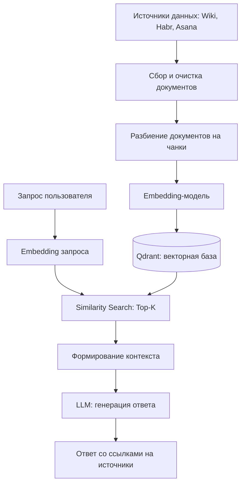
Агентский режим

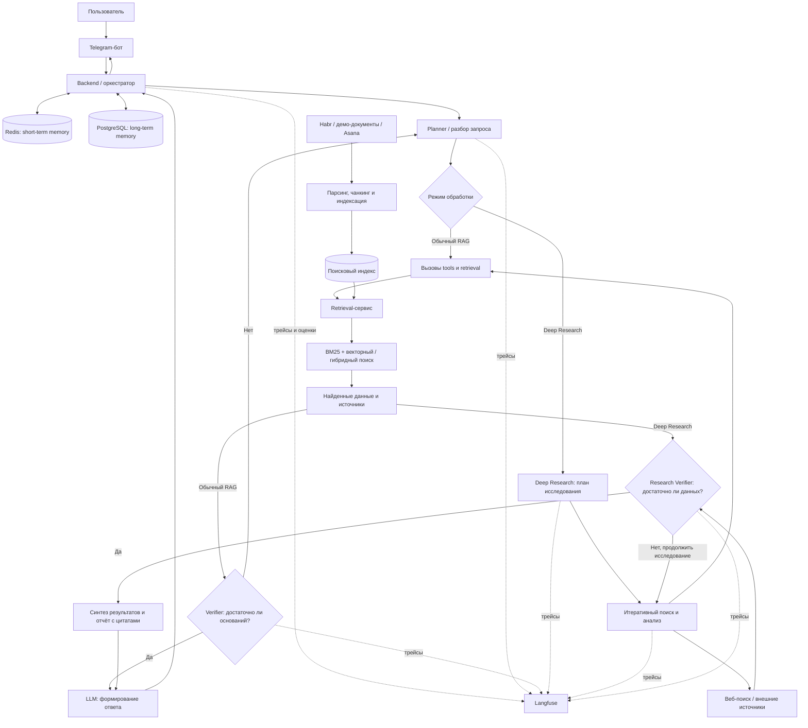

Блок-схема поэтапного плана разработки MVP

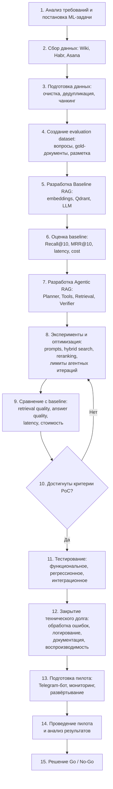

## 7. Экспериментальный план

| Этап | Что делаем | Артефакт |
| --- | --- | --- |
| 1 | Фиксируем snapshot корпуса и eval-набора | Версия данных/индекса |
| 2 | Запускаем baseline на всех вопросах | Baseline-метрики |
| 3 | Запускаем agentic RAG на тех же вопросах | Agent-метрики |
| 4 | Считаем Recall@10, MRR@10, Hit@10, latency, стоимость | Сравнительный отчёт |
| 5 | Ручным аудитом проверяем ошибки и groundedness на подвыборке | Error analysis |
| 6 | Решаем, нужен ли агентный контур в следующей итерации | Go/no-go и backlog |

## 8. Риски, компромиссы и открытые вопросы

| Риск / вопрос | Последствие | Митигация / следующий шаг |
| --- | --- | --- |
| Галлюцинации даже при retrieval | Недостоверные ответы | Проверять источники, замерять groundedness, предусмотреть отказ при недостатке данных |
| Рост latency у агентов | Негативный пользовательский опыт | Лимиты шагов, таймауты, сравнение с baseline |
| Рост стоимости LLM | Низкая экономическая эффективность | Учёт токенов и цены, маршрутизация простых вопросов на baseline |
| Несоответствие синтетических вопросов реальной нагрузке | Переоценка качества | Ручной аудит и пользовательский eval-набор |
| Несанкционированный доступ к данным | Риск раскрытия информации | Для PoC — только безопасные данные; RBAC/ACL до production |
| Изменение внешних источников/API | Нестабильность поиска | Версионирование индекса, ретраи, обработка ошибок |

## 9. Данные: происхождение, получение и назначение

### 9.1. Реестр источников (data inventory)

Ниже разделены **реальные источники демо**, **планируемые интеграции** и **служебные данные**. Указание источника не означает, что в индексе присутствуют все его документы.

| Источник                | Откуда берём                                                     | Как получаем / используем                                                           | Что хранится/нужно                                                                                                                   |
|-------------------------|------------------------------------------------------------------|-------------------------------------------------------------------------------------|--------------------------------------------------------------------------------------------------------------------------------------|
| **Статьи Habr**         | Публичные URL `https://habr.com/ru/articles/{id}`                | Скрипт посылает `POST /ingest` в retrieval API, передавая URL, `doc_id` и metadata. | Текст, идентификатор, URL, источник; после обработки — чанки/embeddings.                                                             |
| **Asana (аналог Jira)** | Демонстрационный проект Asana                                    | Интеграция через tool. Нужно проверить кодом: live API или локальный кэш/индекс.    | ID задачи, название, описание, статус, проект, исполнитель/срок/комментарии **только при наличии прав и соответствующих API-полей**. |
| **Вопросы и диалоги**   | Telegram-бот и backend                                           | Runtime-входы; Redis — краткосрочный контекст, PostgreSQL — долговременная память.  | Контекст, обезличенные идентификаторы сессий; схема полей .                                                                          | 
| **Трейсы и оценки**     | Backend/retrieval/agent → Langfuse                               | Tracing и evaluation.                                                               | Tool calls, ошибки, latency, оценки, токены при наличии; полная схема .                                                              | 
| **Синтетический eval**  | LLM-generated вопросы, соответствующие демонстрационному корпусу | Генерация → нормализация → review → версия датасета → запуск benchmark.             | Query, gold relevant IDs, при возможности reference answer, тип задачи/источник.                                                     |

### 9.2. Контракт данных документа (предлагаемая схема)

| Поле                       | Тип           | Значение / правило                                                    |
|----------------------------|---------------|-----------------------------------------------------------------------|
| `source`                   | string enum   | `habr`, `asana`, `demo_wiki` и др.                                    |
| `source_id`                | string        | Исходный ID статьи, задачи или файла; уникален **в паре с `source`**. |
| `document_id`              | string        | Стабильный ключ, например `habr:1022426`; не зависит от чанкинга.     |
| `source_url`               | string/null   | Каноническая ссылка; для демо-файла допустим repo path.               |
| `title`                    | string/null   | Заголовок, если доступен.                                             |
| `text`                     | string        | Извлечённый и очищенный контент.                                      |
| `created_at`, `updated_at` | datetime/null | Время из источника, не подменять временем загрузки.                   |
| `ingested_at`              | datetime      | Когда запись обработана пайплайном.                                   |
| `content_hash`             | string        | Хеш нормализованного текста для дедупликации/переиндексации.          |
| `metadata`                 | object        | Тип документа, категория, проект, язык, разрешённые поля.             |
| `access_scope`             | string/list   | Для PoC — только публичный или тестовый корпус; будущая проверка ACL. |

### 9.3. Контракт чанка и retrieval-кандидата

| Поле                                | Тип              | Назначение                                                            |
|-------------------------------------|------------------|-----------------------------------------------------------------------|
| `chunk_id`                          | string           | Уникален при заданных `document_id` и версии чанкинга.                |
| `document_id`                       | string           | Ссылка на исходный документ.                                          |
| `chunk_index`                       | int              | Порядковый номер фрагмента.                                           |
| `chunk_text`                        | string           | Текст для embedding и выдачи контекста.                               |
| `chunk_size_tokens`                 | int              | Контроль бюджета контекста.                                           |
| `embedding_model_version`           | string           | Воспроизводимость индекса.                                            |
| `index_version`                     | string           | Snapshot корпуса/настроек индекса.                                    |
| `score`, `rank`, `retrieval_method` | float/int/string | Поля результата поиска, не обязательно хранимые в исходном документе. |
| `source_url`                        | string/null      | Переносится из документа для проверяемых citations.                   |

Это **целевой контракт**, а не утверждение о существующей схеме Qdrant/API.

### 9.4. Пайплайн получения и подготовки данных

1. **Discovery и разрешения:** перечислить URL/проекты/файлы; проверить публичность, правила использования Habr и разрешённость извлечения контента; получить доступ к тестовому Asana-проекту.
2. **Ingest:** для Habr отправить URL, ID, metadata через `/ingest`; для Asana — использовать разрешённые tool/API-операции либо отдельную синхронизацию после подтверждения способа интеграции.
3. **Парсинг:** извлечь основной текст, удалить навигацию/HTML-шум, сохранить заголовки и полезные списки/таблицы; не считать неуспешные ответы HTTP успешно загруженными документами.
4. **Валидация:** проверять пустой текст, ошибки парсинга, язык, повторяющиеся URL/ID, очевидный мусор, слишком короткие/длинные записи, неверные metadata. Сохранять счётчики ошибок и причин пропуска.
5. **Нормализация и дедупликация:** унифицировать кодировку, пробелы, канонические URL, `source_id`, сделать content hash; обновлять изменившийся документ, а не дублировать его.
6. **Chunking:** делить по смысловым/структурным границам с ограничением токенов, сохранять заголовок и происхождение. **[Стартовая гипотеза]** 500–800 токенов/чанк и 10–20% overlap — только для сравнения, фактические параметры проекта **[TBD]**.
7. **Embeddings и индекс:** фиксировать модель/версию embeddings, размерность, тип метрики, версию и число чанков.
8. **Публикация snapshot:** `corpus_version`, `ingestion_timestamp`, список документов и checksum; отдельная версия eval-набора. Смена модели embeddings или схемы чанкинга требует переиндексации и нового benchmark.
9. **Обновление/удаление:** **[Проектное решение]** incremental sync по `updated_at`/hash, удаление устаревших чанков, обработка `404` и удалённых записей. Частоту синхронизации согласовать отдельно.

### 9.5. Первичная EDA и проверки качества

До сравнения моделей собрать таблицу по каждому источнику:

| Проверка                                  | Формула / что фиксируем                                                   | Статус                                                          |
|-------------------------------------------|---------------------------------------------------------------------------|-----------------------------------------------------------------|
| Число доступных/успешно ingest-документов | `successful_ingest / attempted_ingest`                                    | **[TBD]**; для Habr известно лишь число попыток скрипта.        |
| Парсинг                                   | Доля записей с непустым `text` и допустимой длиной                        | **[TBD]**.                                                      |
| Дубликаты                                 | Доля повторов `(source, source_id)` и совпавших `content_hash`            | **[TBD]**.                                                      |
| Размеры                                   | p50/p95 tokens на документ и чанк, число чанков на документ               | **[TBD]**.                                                      |
| Coverage                                  | Доля вопросов eval, для которых существуют gold-источники в snapshot      | **[TBD]**.                                                      |
| Freshness                                 | Распределение `ingested_at - updated_at` по источникам                    | **[TBD]**, для статичных demo-снимков неприменимо.              |
| Metadata correctness                      | Валидность URL, ID, категории, даты, авторства                            | **[TBD]**; известна проблема константного поля `author` у Habr. |
| Data leakage                              | Пересечение одинаковых/почти одинаковых вопросов и документов между split | **[TBD]**.                                                      |

### 9.6. Обновление, хранение и владельцы данных

| Ресурс                | Назначение                  | Владелец/роль                                  | Политика                                                                             |
|-----------------------|-----------------------------|------------------------------------------------|--------------------------------------------------------------------------------------|
| Habr и демо-документы | Корпус поиска               | DS/ML Engineer, владелец источника             | Разрешённый ingest, версия snapshot; точная периодичность **[TBD]**.                 |
| Asana                 | Текущие записи task-tracker | Разработчик интеграции + владелец test-проекта | Least privilege, не логировать токены, проверить scope API.                          |
| Qdrant                | Векторный индекс            | ML Engineer                                    | Переиндексация при смене embeddings/чанкинга, snapshots/backup — следующая итерация. |
| Redis                 | Short-term memory           | Backend Engineer                               | TTL/очистка/изоляция сессий — проверить в коде **[TBD]**.                            |
| PostgreSQL            | Long-term memory            | Backend Engineer                               | Минимизация хранения и процедура удаления — проверить в коде **[TBD]**.              |
| Langfuse              | Трейсы/оценки               | ML Engineer                                    | Маскирование PII/secrets; сроки хранения и права — **[TBD]**.                        |
| Eval-набор            | Регрессионные тесты         | DS + reviewer                                  | Версионирование, ручная разметка подвыборки и запрет тестового leakage.              |

## 10. Дополнение к ML System Design: этапы разработки RAG на едином корпусе

### Этап 1. Подготовка данных

**Задача:** сформировать воспроизводимый корпус документов и разметку для независимого сравнения базового RAG и Agentic RAG. Исходным исследованным источником являются публичные статьи Хабра. Источники Asana  рассматриваются как последующее расширение и требуют отдельной проверки качества.

**Источники и схема.** В исследовании запрашивались ID `1105348–1106348` (1001 возможный ID), из которых через использовавшийся API удалось получить **432 статьи**. Отказы HTTP 404/403 учитываются отдельно; HTTP 404 внутреннего API не означает доказанного отсутствия HTML-страницы. Для каждого успешного документа доступны `article_id`, URL, заголовок, автор, время публикации, хабы и теги, текст и производные признаки EDA. После очистки сохраняются `document_id`, `source_url`, `content_hash`, `corpus_version`, исходная дата публикации и служебная дата индексации. Для чанка: `chunk_id`, `document_id`, текст, границы в документе, токены, ссылки на исходный фрагмент, версия чанкинга и индексирования. Ожидается расширение всех этих данных.

**Подготовка:** проверка корректного HTTP-ответа и пригодности материала → извлечение содержимого из HTML/JSON → очистка навигационного шума → сохранение заголовков, таблиц и кода → нормализация пробелов и кодировки → проверка пустых текстов/дубликатов → структурный чанкинг → сохранение исходных URL/смещений → индексация. Чужие тексты и их использование при генерации запросов допускаются только с учётом правил источника и прав на контент.

#### Этап 1.1. Проведённый EDA статей Хабра

| Наблюдение из предоставленных CSV | Значение | Решение для RAG |
|---|---:|---|
| Количество статей | **432** | Версионировать этот snapshot; не обобщать выводы на все статьи Хабра |
| Медиана / p95 длины | **4 546,5 / 15 162,2 токена** | Индексировать фрагменты, а не статьи целиком; контролировать длинные хвосты |
| Максимальная длина | **69 559 токенов** | Явно ограничивать вход embedding-модели и не усекать документ без разбиения |
| Статьи с кодом | **111 / 432 (25,7%)** | Сохранять fenced code blocks, не разрывать код без необходимости |
| Статьи с таблицами | **122 / 432 (28,2%)** | Сохранять структуру таблиц и их заголовки |
| Статьи с изображениями | **369 / 432 (85,4%)** | Учитывать ограничения text-only RAG и сохранять подписи/alt, если есть |
| Пустые статьи / точные дубликаты | **0 / 0** по используемым эвристикам | Не считать это доказательством отсутствия смысловых дублей |
| Временной срез | **ноябрь 2026**, по выборке — 9–12 ноября | Не использовать для выводов об исторической актуальности статей |

**EDA: объём, время, тематика и язык.** Распределения токенов и символов имеют длинный правый хвост: средние значения не заменяют перцентили. Хабы и теги частично пересекаются, поэтому суммы частот по категориям могут превышать число статей. Большинство статей распознаны как русскоязычные; редкие метки другого языка следует проверять вручную, особенно если внутри русского текста много английского кода.

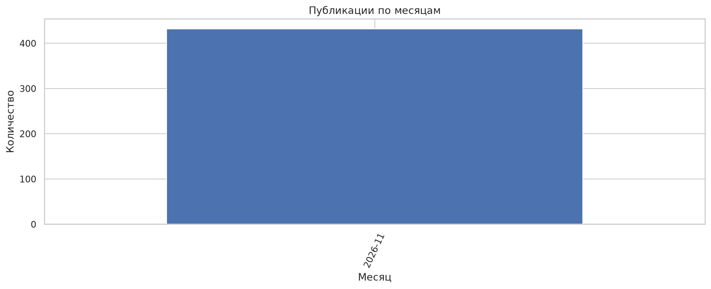

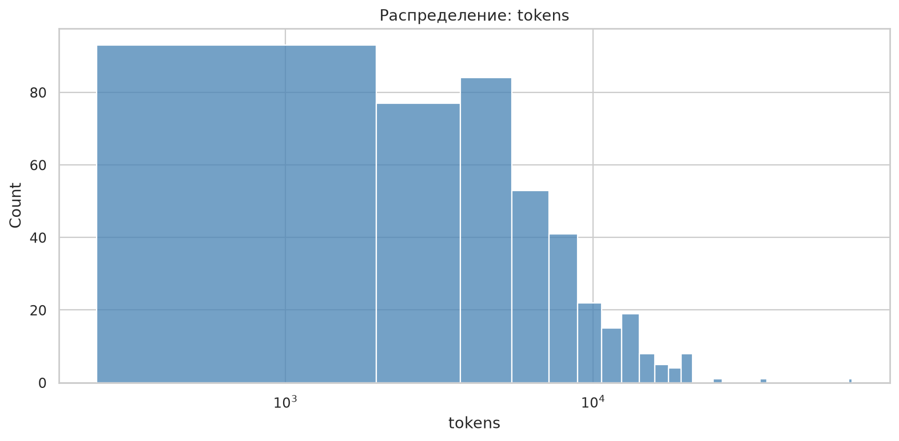

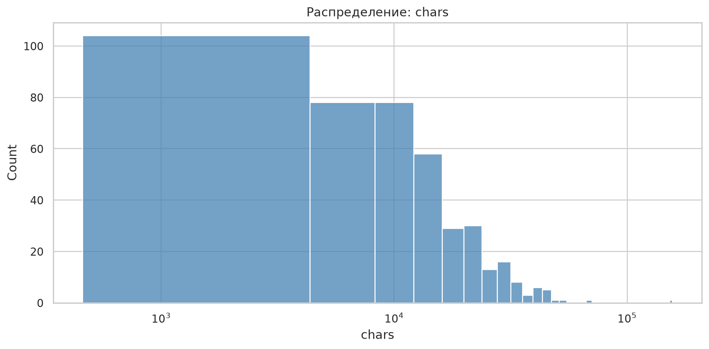

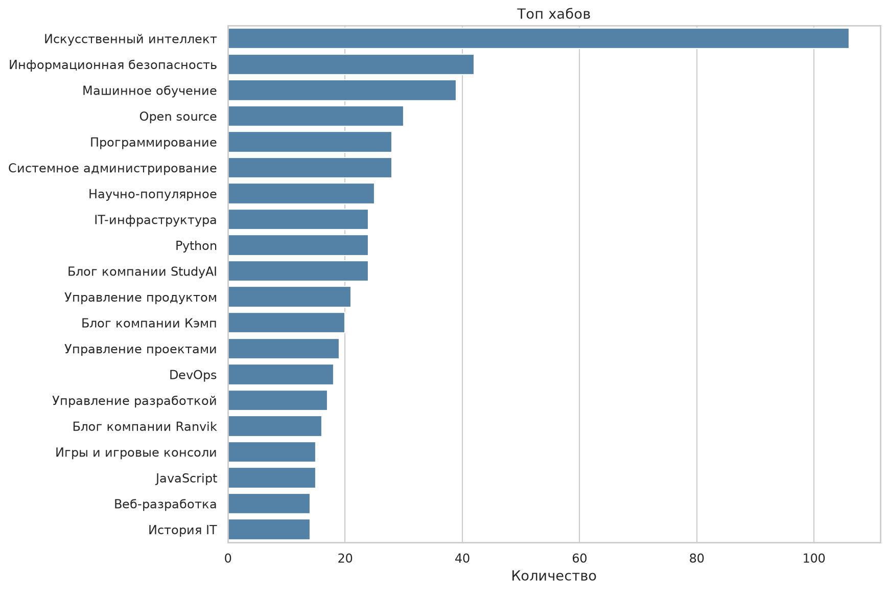

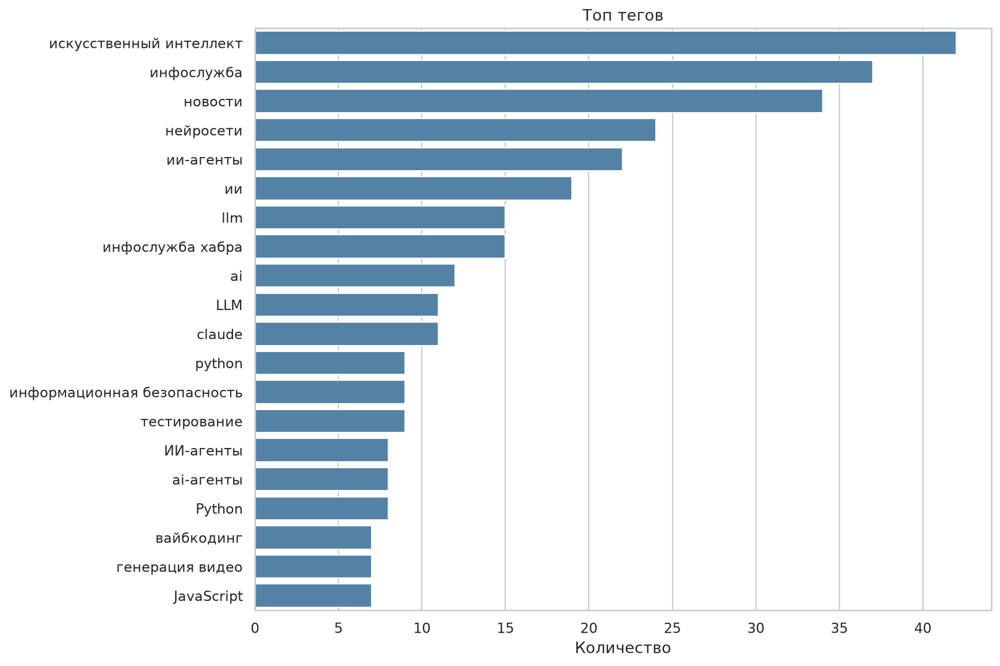

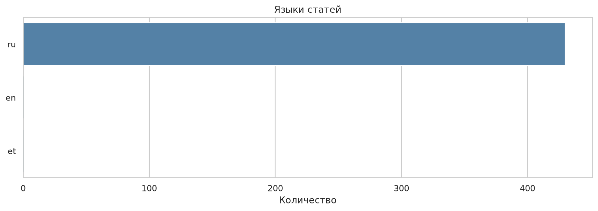

**EDA: структура и качество содержимого.** Структура статей неоднородна: не каждый документ имеет много заголовков и блоков кода; встречаются материалы, где смысловая информация содержится в иллюстрациях и таблицах. Поэтому при извлечении текста нужна выборочная ручная проверка HTML → текст/Markdown, а при чанкинге — контроль целостности технических элементов. Уровень сложности `unknown` означает отсутствие или неоднозначность метаданных, а не «среднюю» сложность.

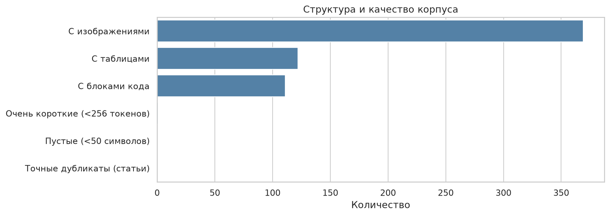

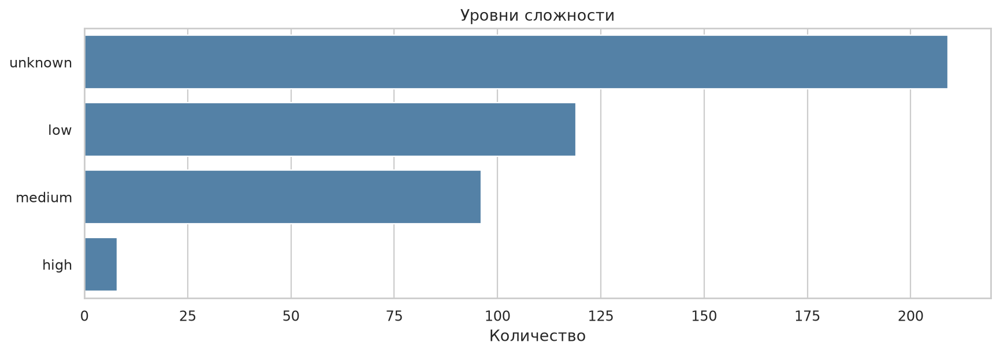

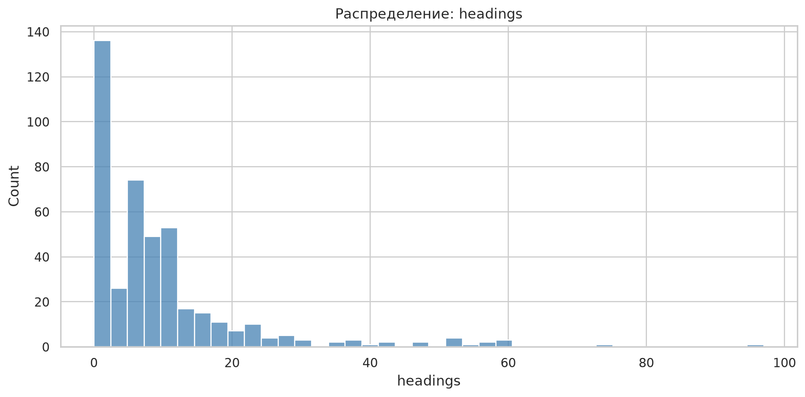

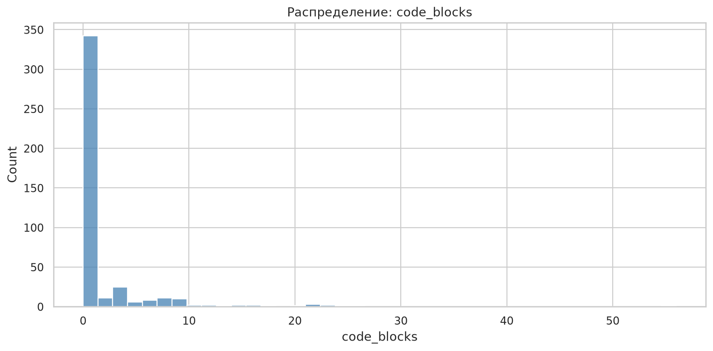

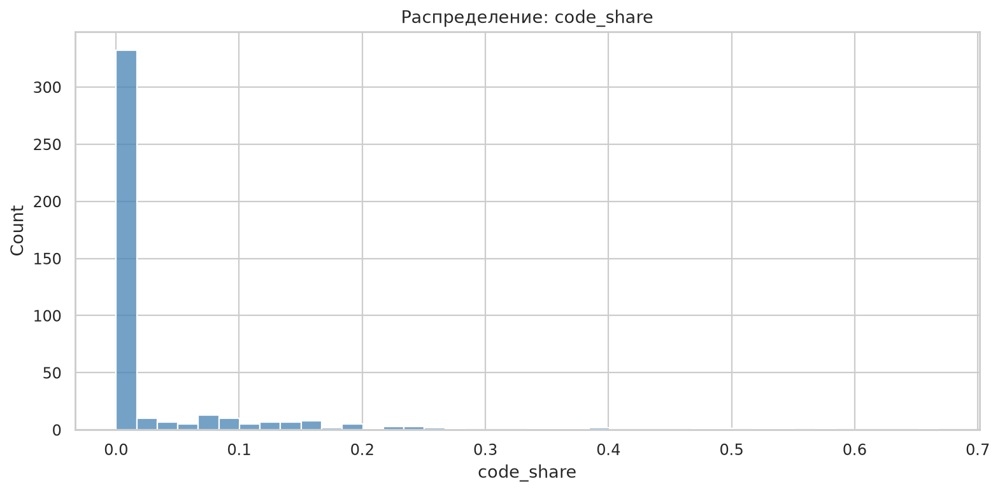

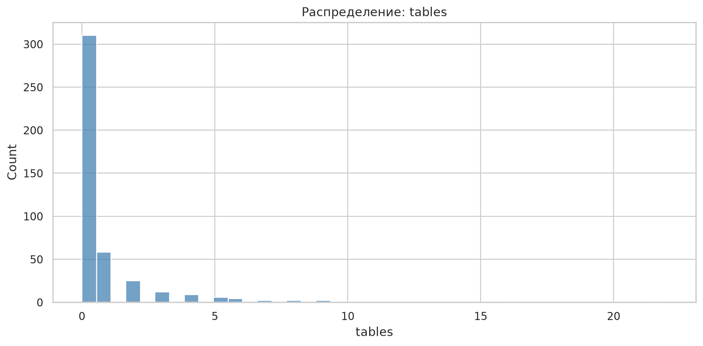

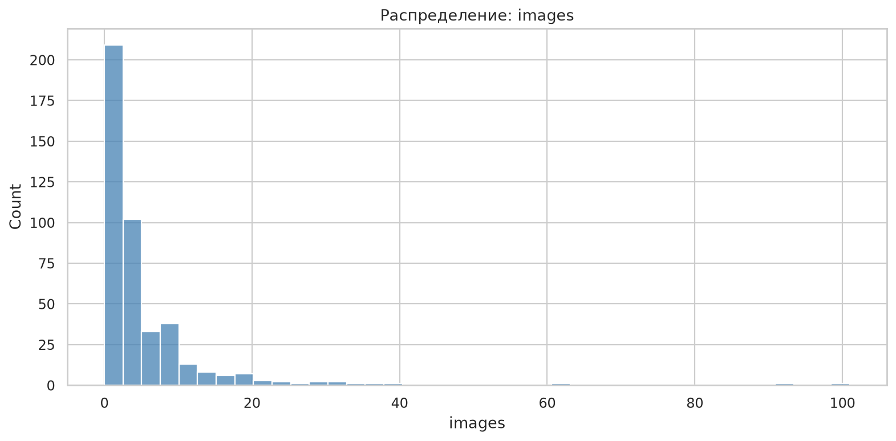

**Семантическое покрытие.** Для 432 статей построена двумерная карта эмбеддингов `intfloat/multilingual-e5-large` с UMAP. График показывает локальные группы похожих документов и смешение категорий; UMAP — визуальная диагностика, **не метрика Recall/MRR** и не доказательство того, что retrieval готов к работе. Векторы для этой визуализации не следует путать с окончательным версионированным индексом чанков.

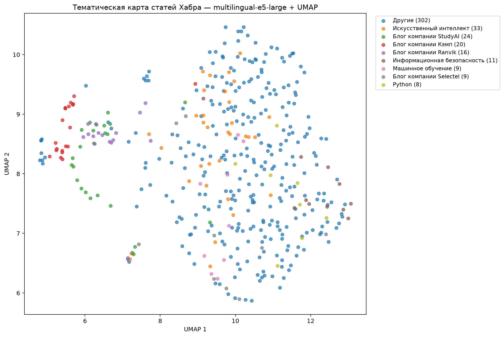

#### Этап 1.2. Анализ чанкинга и выбор фиксированного представления

Сравнивались четыре способа сегментации одного и того же корпуса. Метрика `code_fence_broken_share` — **эвристический индикатор** потенциально разорванных Markdown code fences, а не ручная оценка повреждения кода.

| Стратегия | Всего чанков | Среднее число на статью | Доля чанков <128 токенов | Доля потенциально разорванных code fences |
|---|---:|---:|---:|---:|
| `fixed_256_o32` | 11 569 | 26,78 | 1,63% | 4,20% |
| `fixed_512_o64` | 5 861 | 13,57 | 1,16% | 4,59% |
| `fixed_1024_o128` | 3 002 | 6,95 | 0,00% | 5,00% |
| `heading_512` | 6 695 | 15,50 | 11,65% | 3,24% |

`heading_512` лучше сохраняет границы code fences **по эвристике**, но создаёт заметно больше коротких чанков. `fixed_512_o64` — возможная контрольная конфигурация для MVP, а не установленный победитель. Для E5 необходимо отдельно проверить **реальное число токенов токенизатором модели** (контекстное ограничение 512 токенов с учётом префикса), чтобы избежать скрытого truncation. Победитель по чанкингу определяется только на **одинаковых gold-вопросах** с измерением retrieval-метрик и проверкой примеров.

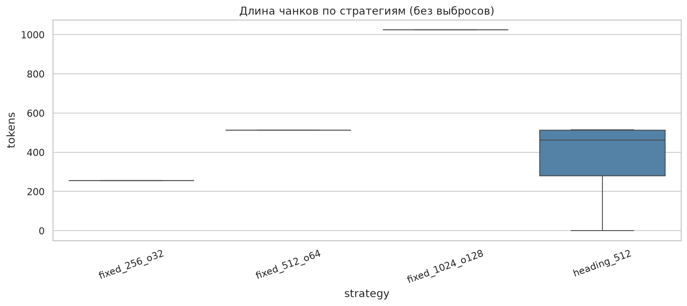

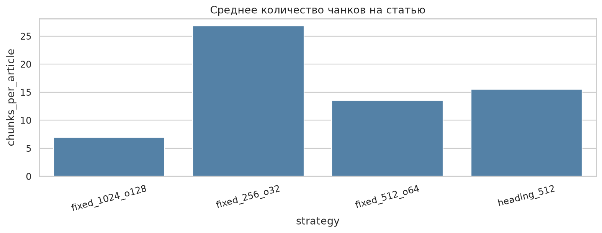

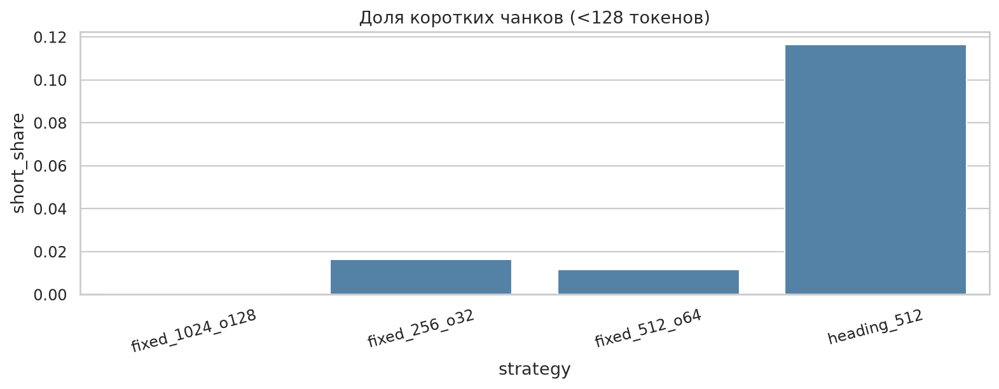

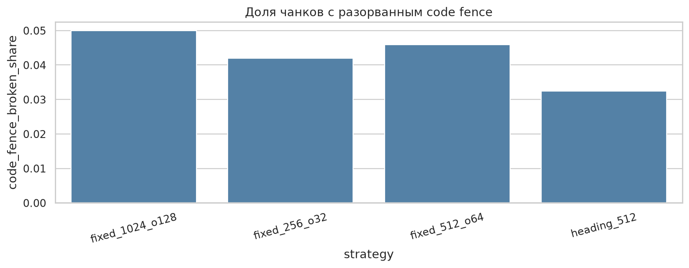

#### Этап 1.3. Создание и генерация evaluation dataset

Для объективного сравнения Baseline RAG и Agentic RAG планируется сформировать **единый evaluation dataset**, содержащий пользовательские вопросы, эталонные ответы и релевантные источники информации.

Датасет будет создаваться двумя способами: **автоматическая генерация вопросов с помощью LLM** и **ручная разметка экспертами**.

**Автоматическая генерация датасета**

Для формирования синтетического набора вопросов используется следующий алгоритм:

1. **Отбор документов.** Из проиндексированного корпуса выбираются фрагменты документов с учётом тематики, длины и информативности. Это позволит получить разнообразные вопросы и снизить тематический дисбаланс.
2. **Генерация вопросов и ответов.** LLM получает выбранный фрагмент и формирует естественный пользовательский вопрос и эталонный ответ, основанный исключительно на предоставленной информации.
3. **Формирование разных типов вопросов.** Помимо простых фактологических вопросов, планируется генерировать вопросы на объяснение причин, сравнение подходов, анализ технических решений и объединение информации из нескольких документов.
4. **Проверка качества.** Сгенерированные пары проверяются на корректность, однозначность, соответствие исходным документам и отсутствие дубликатов. Отдельно формируются вопросы, на которые в корпусе нет ответа, для оценки способности системы корректно отказывать в генерации.
5. **Сохранение разметки.** Для каждого вопроса фиксируются эталонный ответ, релевантные документы, тип вопроса и уровень сложности.

**Ручная разметка контрольного набора**

Дополнительно планируется **вручную сформировать и разметить 120 вопросов** для независимого сравнения RAG-систем:

| Тип вопроса | Количество | Назначение |
|---|---:|---|
| Простые фактологические | 40 | Проверка поиска и извлечения информации из одного источника |
| Многодокументные | 40 | Проверка объединения информации из нескольких документов |
| Сложные составные | 40 | Проверка декомпозиции запроса, многошагового поиска и полноты ответа |
| **Итого** | **120** | **Единый контрольный набор для сравнения** |

Для каждого вопроса вручную определяются эталонный ответ и релевантные источники, необходимые для его формирования.

Ручная разметка позволит снизить зависимость оценки от ошибок синтетической генерации и обеспечить более объективное сравнение качества разных подходов.

**Методика использования датасета**

Все сравниваемые системы будут оцениваться на **одинаковом наборе вопросов и одном snapshot корпуса документов**. Для векторных компонентов будет использоваться единый заранее рассчитанный набор эмбеддингов и одинаковые проиндексированные чанки.

Синтетический датасет используется для разработки, предварительного тестирования и подбора параметров RAG. Ручной набор из 120 вопросов применяется для финального независимого сравнения Baseline RAG и Agentic RAG.

Основные метрики оценки: `Recall@10`, `MRR@10`, `Answer Correctness`, `Completeness`, `Groundedness`, а также задержка и стоимость обработки запросов.

**Результат этапа:** синтетический QA-датасет для разработки и тестирования, вручную размеченный контрольный набор из 120 вопросов и единая методика оценки всех сравниваемых RAG-систем.

### Этап 2. Подготовка прогнозных моделей

**Задача:** подготовить воспроизводимый baseline и критерии выбора методов поиска и генерации. В текущем PoC не планируется обучение собственной прогнозной модели с нуля: используются готовые BM25, embedding-модель и LLM. Поэтому функция потерь для baseline не оптимизируется; если позднее будет дообучение retriever, допустимо исследовать contrastive / ranking loss с отдельной валидацией.

| Компонент | Baseline / кандидат | Эксперимент и проверка |
|---|---|---|
| Лексический поиск | BM25 | Exact-match термины, названия библиотек, версии, ID |
| Dense retrieval | `intfloat/multilingual-e5-large` | Семантические запросы на русском; `passage:` для документов, `query:` для запросов |
| Hybrid retrieval | BM25 + E5, например RRF | Сравнение с каждым компонентом на одних и тех же QA |
| Reranker | Опциональный cross-encoder поверх общих кандидатов | Повышение nDCG/MRR против добавленной задержки |
| Generator | Одна фиксированная LLM и версия промпта для основной пары режимов | Корректность, groundedness, цитаты, стоимость и latency |

**Главное правило честного сравнения — один и тот же набор векторов для всех систем:** после отдельного эксперимента по чанкингу фиксируются **одна версия корпуса, одна стратегия сегментации, один набор `chunk_id`, одна embedding-модель и одни заранее посчитанные 1024-мерные векторы документов**. Эти векторы хранятся в общем неизменяемом snapshot коллекции Qdrant; baseline dense RAG, hybrid RAG и Agentic RAG обращаются **к одним и тем же документным векторам**, а не строят себе независимые индексы. Одинаковый запрос кодируется одной и той же моделью и конфигурацией. Агент вправе формулировать **другие запросы** — их query-векторы отличаются из-за текста, но **документные векторы остаются теми же**. BM25 сам по себе векторы не использует, однако работает **по тем же `chunk_id` и текстам**.

**Важное разграничение:** эксперименты `fixed_256`/`fixed_512`/`heading_512` меняют набор чанков и, следовательно, требуют **отдельных тестовых индексов**. Они проводятся как *предварительный выбор подготовки данных*. В **основном сравнении архитектур** preprocessing заморожен и остаётся общим — иначе разницу качества нельзя будет приписать именно RAG или агентному планированию.

**Проверка и выбор:** retrieval оценивается по `Recall@5/10`, `Hit@10`, `MRR@10`, при наличии ранговой разметки — `nDCG@10`; ответы — по correctness, completeness, groundedness и корректности ссылок; дополнительно p50/p95 latency, TTFT, токены и cost/query. Тестирование проводить на одних вопросах и gold-документах с фиксацией версий корпуса, LLM, индекса, системного промпта, `top-k` и случайных seed, если они применимы. **Численных результатов качества моделей в приложенном EDA нет**.

**Результат этапа:** таблица конфигураций, единый snapshot эмбеддингов/текстов, реализованный baseline и заранее зафиксированный протокол оценки.

### Этап 3. Специфический этап RAG — индексация, retrieval и формирование контекста

**Offline-контур:** загруженные документы → фиксированный чанкинг → `passage:`-эмбеддинги E5 (с контролем длины) → единая коллекция Qdrant (`chunk_id` + текст + URL + `document_id` + version) и параллельный BM25 по тем же фрагментам. Для честного A/B-теста запрещено пересоздавать эмбеддинги, менять порядок фильтрации или обогащать корпус только для одной системы.

**Online-контур:** вопрос → нормализация → BM25 / E5 dense / hybrid → объединение и дедупликация кандидатов → опциональный reranking → ограничение по токенам контекста → передача в LLM вместе с URL и идентификаторами источников. Контекст не должен содержать сам `ground_truth_answer` из eval-набора.

**Контроль качества:** gold evidence и привязка к документам позволяют отличать `retrieval failure` от `generation failure`. Измеряются Recall/Hit/MRR, покрытие нужных источников в контексте, доля отрезанных таблиц/code fences и доля источников без валидного URL. На запросах с версиями технологий оценивается необходимость фильтрации по дате; на пустом контексте — корректный отказ.

**Результат этапа:** один общий индекс, воспроизводимая retrieval-функция и диагностические трейсы для всех сравниваемых режимов.

### Этап 4. Специфический этап RAG — генерация ответа, Agentic RAG и оценка

**Сравниваемые варианты работают с общими данными и документными векторами из этапов 2–3:**

1. **Baseline RAG:** один вопрос → один retrieval top-k → LLM → ответ со ссылками.
2. **Agentic RAG:** planner декомпозирует сложный вопрос → несколько последовательных вызовов **того же retrieval-сервиса** → verifier проверяет достаточность evidence → та же LLM формирует ответ со ссылками. Для простых запросов агент может не делать дополнительные шаги.

**Ограничения агента для PoC:** ограниченное количество шагов (начальная гипотеза — до 3 поисковых итераций), таймауты, ограничения токенов и стоимости, запрет считать инструкции внутри найденных статей управляющими командами. При нехватке evidence система должна сообщать об ограничениях, а не придумывать недостающие факты.

**Эксперимент:** оба режима проходят один и тот же зафиксированный QA dataset, при одинаковых документах, document embeddings, embedding/query encoder, версии LLM и условиях доступа к источникам. Для каждого кейса сохраняются gold IDs, top-k, список реально использованных источников, ответ, оценки quality, TTFT/end-to-end latency и стоимость. LLM-as-Judge оценивает correctness/completeness/groundedness вслепую по отношению к режиму; часть оценок перепроверяет человек. Сравнение проводится отдельно для простых, многодокументных и составных запросов, чтобы улучшение на сложных вопросах не маскировало удорожание простых.

**Критерии успешности — целевые, ещё не измеренные:** средняя оценка ответа Agentic RAG ≥ 4/5 и улучшение над baseline ≥ 0,3 балла; на сложных вопросах ≥ 0,5 балла; Recall@10 не падает более чем на 2 п.п.; p95 TTFT ≤ 15 с; p95 полного ответа ≤ 40 с; средний cost/query ≤ 3× baseline; технические ошибки ≤ 2%. Никаких фактических результатов достижения порогов пока нет.

**Результат этапа:** воспроизводимый сравнительный benchmark и решение Go/No-Go по применению агентного подхода. На этом шаге можно доказать или опровергнуть пользу Agentic RAG — данные EDA сами по себе её не доказывают.
