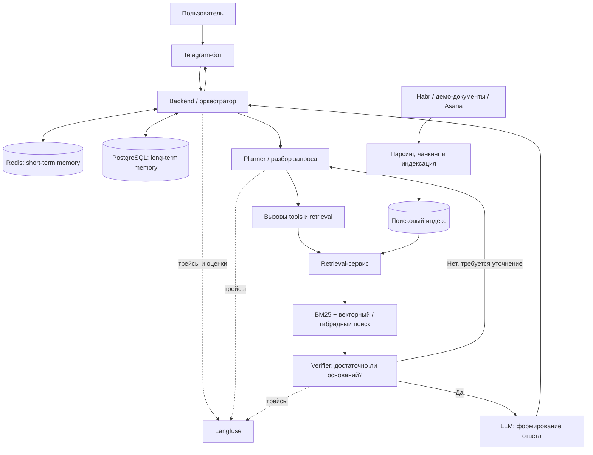

# ML System Design Document — Agent-Enhanced Corporate Search

**Тип:** исследовательский Proof of Concept (PoC)
**Статус:** документ фиксирует постановку задачи, проектные предположения и критерии оценки
**Дата актуализации:** 27 октября 2026 года

> **Статус утверждений.** Описание  компонентов. Целевые пороги, SLA и бизнес-KPI ниже являются *предлагаемыми критериями PoC*, а не подтвержденными требованиями заказчика.

## 1. Зачем идём в разработку продукта?

### 1.1. Бизнес-контекст и проблема

Знания условной компании разрознены по корпоративной wiki, трекерам задач, технической документации и внешним источникам. Разработчики, аналитики, продакт-менеджеры и другие сотрудники тратят время на поиск актуальной информации и восстановление контекста. Обычный keyword-поиск недостаточно хорошо обрабатывает длинные и составные вопросы. Базовый RAG может пропускать релевантные источники и генерировать ответы, которые не подтверждаются найденными документами.

### 1.2. Цель продукта

Создать корпоративного чат-ассистента, который находит информацию в нескольких источниках, объединяет её в связный ответ и позволяет проверить основание ответа. Исследовательская цель PoC — проверить, повышают ли AI-агенты полноту и качество ответов по сравнению с базовым RAG без неприемлемого увеличения задержки и стоимости.

### 1.3. Целевая аудитория и сценарии

- Разработчик ищет связанные технические решения и документацию по сервису.
- Аналитик сопоставляет несколько документов и задач для выяснения требований.
- Продакт-менеджер уточняет историю проекта, статусы задач и принятые решения.
- Участник команды задаёт составной вопрос, для которого недостаточно одного поискового запроса.

### 1.4. Ожидаемый эффект

Сокращение времени поиска информации, уменьшение числа повторных уточняющих вопросов, рост доли ответов с подтверждающими источниками и улучшение пользовательского доверия. На данном этапе эффект рассматривается как гипотеза, которую необходимо измерить в пользовательских испытаниях.

## 2. Бизнес-требования и ограничения

### 2.1. Функциональные требования

| ID | Требование | Проверка |
| --- | --- | --- |
| FR-1 | Принимать вопросы пользователя в чат-интерфейсе | Демонстрация диалога через Telegram-бота |
| FR-2 | Искать данные по нескольким источникам, включая документы и задачи | Проверка сценариев с разными инструментами |
| FR-3 | Поддерживать лексический, векторный и гибридный поиск | Тесты retrieval-сервиса |
| FR-4 | Разбивать сложный вопрос на подзадачи и выполнять последовательный поиск | Трейсы агента с шагами планирования и retrieval |
| FR-5 | Проверять достаточность найденной информации перед генерацией ответа | Тест-кейсы verifier и анализ неподтверждённых утверждений |
| FR-6 | Сохранять контекст диалога и позволять его очищать | Демонстрация short-term / long-term memory |
| FR-7 | Логировать запросы, шаги агентов, ошибки и результаты оценивания | Наличие трейсов в Langfuse |
| FR-8 | Сравнивать baseline RAG и agentic RAG на едином наборе вопросов | Воспроизводимый benchmark |

### 2.2. Нефункциональные требования и ограничения

| Категория     | Требование / ограничение                                                                            | Статус                   |
|---------------|-----------------------------------------------------------------------------------------------------|--------------------------|
| Качество      | Не ухудшать retrieval-качество по отношению к baseline; проверять groundedness ответов              | Критерий для PoC         |
| Задержка      | Измерять p50/p95 end-to-end latency; согласовать допустимый порог после baseline-измерений          | Порог не утверждён       |
| Стоимость     | Измерять токены, обращения к LLM и стоимость на запрос                                              | Критерий для PoC         |
| Безопасность  | Не помещать реальные корпоративные секреты в публичный репозиторий и бенчмарки                      | Обязательное ограничение |
| Приватность   | Анонимизировать пользовательские данные в логах и соблюдать доступность источников                  | Ограничение PoC          |
| Данные        | В PoC используются эмуляции/демонстрационные источники и статьи Habr; Asana выступает аналогом Jira | Ограничение PoC          |
| Эксплуатация  | Для PoC допустимы ручная настройка и развёртывание; промышленное SLA не обещается                   | Ограничение PoC          |
| Права доступа | Полная корпоративная авторизация и RBAC не реализуются в PoC                                        | Вне скоупа               |

### 2.3. Метрики и критерии успеха

**Retrieval:** Recall@10, Hit@10, MRR@10; в расширенном сравнении — MAP и nDCG.
**Ответы:** качество и обоснованность ответа, оцениваемые LLM-as-judge и ручной разметкой подвыборки.
**Эксплуатация:** p50/p95 latency, доля ошибок, стоимость запроса, число шагов агента.
**Бизнес-прокси:** время до нахождения ответа и доля вопросов, решённых без дополнительного уточнения (после проведения пользовательских тестов).

**Предлагаемый критерий принятия решения:** агентный подход оправдан, если он улучшает качество на фиксированном тестовом наборе при приемлемой стоимости и p95 latency. Численные пороги нужно утвердить после измерения baseline и получения ресурсных ограничений.

## 3. Скоуп проекта и итерации

### 3.1. Входит в PoC

- Чат-интерфейс в Telegram.
- Backend с агентным циклом, planner, verifier и инструментами.
- Retrieval-сервис с BM25, векторным и гибридным поиском; индексация демо-документов.
- Поиск по нескольким источникам, включая Habr и интеграцию с Asana как аналогом Jira.
- Хранение контекста: Redis для краткосрочной и PostgreSQL для долговременной памяти.
- Трейсинг и оценивание через Langfuse; набор синтетических вопросов для benchmark.
- Сравнение baseline RAG и agentic RAG по качеству, задержке и стоимости.
- Реализация полноценного Deep Research.

### 3.2. Не входит в PoC

- Полноценная production-интеграция со всеми источниками корпоративных данных.
- Корпоративная авторизация, разграничение прав на уровне документов (RBAC/ACL).
- Онлайн-обучение и reinforcement learning.
- Полный data / model governance и гарантии промышленного SLA.

### 3.3. Результаты итерации

Прототип, демонстрационные сценарии, воспроизводимый eval-набор, сравнительная таблица baseline и agentic RAG, ограничения и список задач для следующей итерации.

## 4. Предпосылки решения и гипотезы

1. **Несколько источников:** нужные сведения часто распределены, поэтому single-pass retrieval не всегда возвращает все релевантные документы.
2. **Составные запросы:** декомпозиция и планирование поиска могут улучшить recall по сравнению с одним запросом.
3. **Гибридный retrieval:** BM25 помогает при точных терминах и идентификаторах, векторный поиск — при смысловых переформулировках; их комбинация может быть устойчивее каждого способа по отдельности.
4. **Verifier:** проверка ответа по найденным фрагментам может снизить долю неподтверждённых утверждений, но не гарантирует устранение галлюцинаций.
5. **Цена агентности:** дополнительные LLM-вызовы, поиск и перепланирование увеличивают latency и стоимость; поэтому качество необходимо оценивать вместе с затратами.
6. **Синтетические оценки:** LLM-сгенерированный eval-набор удобен на старте, но может иметь смещения; нужна ручная проверка части примеров.

## 5. Постановка ML-задачи

### 5.1. Входы и выходы

**Вход:** запрос пользователя `q`, история диалога `h` и доступный корпус документов `D` (в том числе статьи, документация и задачи).
**Выход:** текстовый ответ `a`, основанный на извлечённых материалах `C ⊆ D`, и диагностическая информация для аудита работы retrieval/агентов.

**Retrieval-задача:** для `q` получить упорядоченный список `top-k` релевантных документов или чанков, максимизируя Recall@k, MRR@k и другие метрики ранжирования.
**Generation-задача:** сформировать полезный ответ на основании найденного контекста без неподтверждённых утверждений.
**Decision-задача PoC:** проверить гипотезу, что агентная декомпозиция и итеративный retrieval улучшают качество относительно baseline при допустимой цене и задержке.

### 5.2. Baseline и исследуемое решение

**Baseline:** один поисковый запрос → retrieval top-k → сбор контекста → ответ LLM.
**Agentic RAG:** анализ и планирование → декомпозиция → вызовы retrieval/tools (при необходимости итеративные) → проверка достаточности контекста → синтез ответа.

### 5.3. Данные и оценивание

- Источники: демонстрационные документы, статьи Habr и задачи Asana, упомянутые.
- Подготовка: получение/парсинг документов, нормализация, разбиение на чанки, индексация.
- Эталонные ответы/релевантность: eval-набор синтетических вопросов; требуется ручной аудит качества разметки.
- Риски: утечка данных из реальных источников, неполнота корпуса, неточная синтетическая разметка, нестабильность LLM-as-judge, смещение к часто встречающимся типам вопросов.

## 6. Блок-схема решения

## 7. Экспериментальный план

| Этап | Что делаем | Артефакт |
| --- | --- | --- |
| 1 | Фиксируем snapshot корпуса и eval-набора | Версия данных/индекса |
| 2 | Запускаем baseline на всех вопросах | Baseline-метрики |
| 3 | Запускаем agentic RAG на тех же вопросах | Agent-метрики |
| 4 | Считаем Recall@10, MRR@10, Hit@10, latency, стоимость | Сравнительный отчёт |
| 5 | Ручным аудитом проверяем ошибки и groundedness на подвыборке | Error analysis |
| 6 | Решаем, нужен ли агентный контур в следующей итерации | Go/no-go и backlog |

## 8. Риски, компромиссы и открытые вопросы

| Риск / вопрос | Последствие | Митигация / следующий шаг |
| --- | --- | --- |
| Галлюцинации даже при retrieval | Недостоверные ответы | Проверять источники, замерять groundedness, предусмотреть отказ при недостатке данных |
| Рост latency у агентов | Негативный пользовательский опыт | Лимиты шагов, таймауты, сравнение с baseline |
| Рост стоимости LLM | Низкая экономическая эффективность | Учёт токенов и цены, маршрутизация простых вопросов на baseline |
| Несоответствие синтетических вопросов реальной нагрузке | Переоценка качества | Ручной аудит и пользовательский eval-набор |
| Несанкционированный доступ к данным | Риск раскрытия информации | Для PoC — только безопасные данные; RBAC/ACL до production |
| Изменение внешних источников/API | Нестабильность поиска | Версионирование индекса, ретраи, обработка ошибок |
